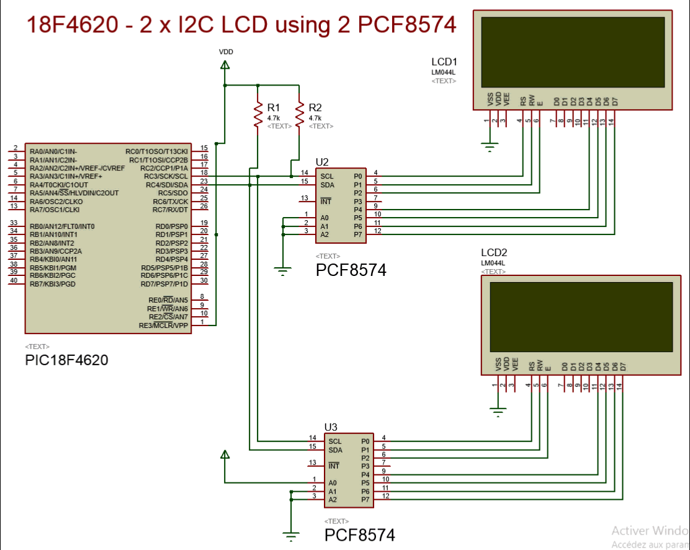
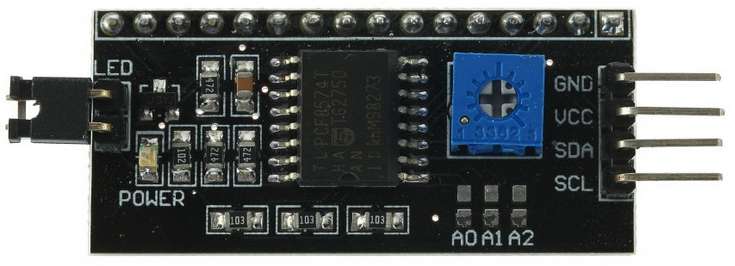
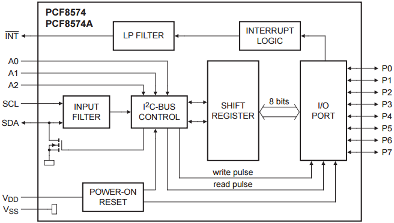
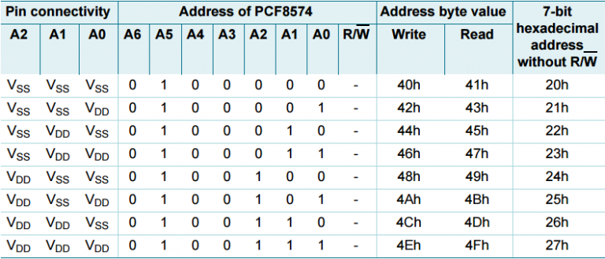
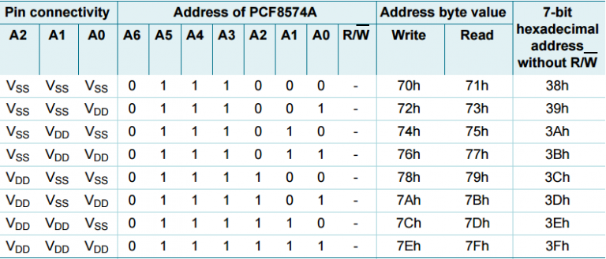
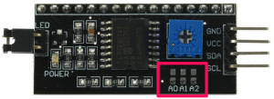
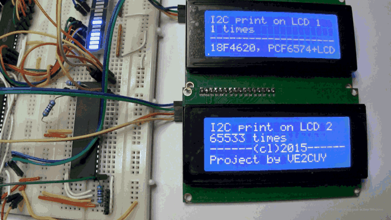

# 18F4620 – 2 x I2C LCD with PCF8574

*Document converti depuis [ve2cuy.com/blog](https://ve2cuy.com/blog/index.php/18f4620-2-x-i2c-lcd-with-pcf8574/) — dernière modification : 2015-04-06*

---

# To my English language readers

The following article is in French.

Here is a summary:

How to display on a I2C LCD using a PCF8574 and a PIC 18F4620.

The Proteus project is available [here](https://drive.google.com/uc?export=download&id=0BwVyrqVfxGkRWFZ4aW9ZQUwyTTA).

**Note**: source code is commented in English.



---

# Mise en situation

Contrairement à nos amis Arduiniens, quand vient le moment d’interconnecter des périphériques à une puce PIC, c’est souvent la recherche sans fin dans Internet.

Pour Pic, moins de librairies spécialisées comme : LiquidCrystal , Wire, Ethernet, Firmata, Servo, WiFi, TFT, EEPROM.

Arduino supportant un nombre limité de puces, cela rend la normalisation des librairies plus simple.

De plus, un grand nombre de contributeurs aident à enrichir les outils de développement.

# De retour chez PIC

Parfois, interfacer une puce PIC à un périphérique est assez facile, [LCD sous PIC](https://www.google.ca/webhp?sourceid=chrome-instant&ion=1&espv=2&ie=UTF-8#q=lcd+interfacing+with+pic+xc8), d’autres fois, pas vraiment.

Tentez de trouver une solution pour connecter un écran LCD en utilisant le protocole I2C via une puce PCF8574.

Le genre de circuit mille fois disponible sur [eBay](http://www.ebay.com/sch/i.html?_from=R40&_trksid=p2050601.m570.l1313.TR4.TRC1.A0.H0.Xlcd+i2c.TRS0&_nkw=lcd+i2c&_sacat=0).



Vrai, il existe des solutions à gauche ou droite, mais quelle misère…

Pour en arriver à une solution fonctionnelle, il faut ramer!

**Scénario 1**

Le module PCF8574 n’est pas documenté:

> ou est RS, CS, E?
>
> et pour le data?

Dans mon cas, j’ai du passer à l’ohmmètre les broches RS, RW,E et D4 à D7 de mon afficheur I2C LCD made in China,

Résultat:

> Data PCA8574: P7,P6,P5,P4  
> Control: P3: Back Light, P2: E-Enable, P1:RW, P0: RS

**Scénario 2**

Vous avez trouvez un bout de code mais misère, pas le bon compilateur, la bonne famille ou le bon langage…

**Scénario 3**

Vous avez la documentation en main et tout va bien, chanceux!

**Scénario 4**

On vous fournit une solution – Proteus –  clé en main, possible?  Voir le lien de téléchargement au bas de l’article.

# Fonctionnement de la plaquette I2C vers LCD

Les plaquettes de conversion des écrans LCD de I2C vers BUS LCD 4 bits utilisent, généralement, la puce PCF8574 ou la PCF8574A.

Ce circuit a pour fonction de désérialiser les données du BUS I2C vers un octet donc, de présenter l’information en parallèle sur 8 bits.



Les écrans LCD HD44780 1602 pouvant être opérés en mode 4 bits, il sera alors possible d’utiliser une partie de l’octet (nibble du bas) pour les signaux de contrôle : RS, RW, E, retro éclairage et l’autre partie (nibble du haut) pour les données.

La difficulté sera de combiner correctement les signaux de contrôle et les données dans un même octet.

L’extraction des nibbles d’un octet de données est habituellement obtenu ainsi:

> #define HI_NIBBLE(b) (((b) >> 4) & 0x0F)  
> #define LO_NIBBLE(b) ((b) & 0x0F)

Étant donné que les signaux de contrôle du LCD sont connectés sur les broches P0 à P3 du PCF8574 et les données sur P4 à P7, nous utiliseront plutôt l’approche suivante:

> #define LO_NIBBLE(b) (((b) << 4) & 0xF0)  
> #define HI_NIBBLE(b) ((b) & 0xF0)

Pour l’ajout des signaux de contrôle à un des deux nibbles nous utiliseront des opérations bit à bit (Bitwise operation).

Par example,

> lcddata = HI_NIBBLE(data) | LCD_BL | LCD_RS;

# Adresse I2C de PCF8574

L’adresse I2C de PCF8574 est située dans la plage 20H à 27H et de 38H à 3Fh pour PCF8574A.

En utilisant ces deux puces dans un même circuit, il serait possible de connecter 16 écrans LCD.

Voici les tableaux d’adressage:





Dans la cas des plaquettes que j’utilise, les broches d’adressage de PCF8674 (A0..A2) sont connectées à VCC via une résistance de tirage (pull-up resistor).  L’adresse maximale de 27H est donc obtenue par défaut.

Il suffit de souder un cavalier sur les bornes A0..A2 pour ramener les broches à 0 et faire ainsi varier l’adresse I2C du circuit.



# À bien y regarder, pas si simple

Même si vous avez bien saisie l’arithmétique des nibbles et les opérations bit à bit, ce n’est encore pas suffisant pour afficher sur l’écran LCD. Pour ce faire, il faudra aussi comprendre la mécanique de programmation et la synchronisation des signaux de la puce contrôlant l’affichage: HD44780.  
Dans le code source du projet, il y a la séquence suivante :

> void LCD_init(unsigned char addr)  
> {  
> __delay_ms(20); // Wait > 15 ms after power ON
>
> LCD_putcmd(addr, LCD_INIT_BYTE,0);__delay_ms(5); // Wait > 4.1 ms  
> LCD_putcmd(addr, LCD_INIT_BYTE,0);  
> LCD_putcmd(addr, LCD_INIT_BYTE,0);  
> LCD_putcmd(addr, LCD_BUS_WIDTH_4Bit,0);  
> LCD_putcmd(addr, LCD_4BITS_2LINES_5x8FONT,1);  
> LCD_putcmd(addr, LCD_DISPLAY_OFF_CURSOR_OFF_BLINK_OFF,1);  
> LCD_putcmd(addr, LCD_CLEAR,1);  
> LCD_putcmd(addr, LCD_INCREMENT_NO_SHIFT,1);  
> LCD_putcmd(addr, LCD_DISPLAY_ON_CURSOR_OFF,1);  
> } // LCD_init()

Ces instructions servent à initialiser le LCD en mode 4 bits, à allumer l’écran, à masquer le curseur, …

Remarquez que des délais sont insérés ici et là.  Il y a des délais aussi dans la fonction LCD_putcmd.

Ces délais sont importants pour assurer le bon fontionnement  de l’écran.

Pour connaître les commandes de contrôles et les délais de programmation de la puce HD44780, je vous revoie à la [documentation](http://fr.wikipedia.org/wiki/HD44780).

# Le projet

Après deux jours de recherches et de prototypage, j’en suis arrivé à une solution de contrôle de deux (2) LCD via I2C pilotés par 2 puces PCF8574.

Mes recherches, dans Internet, m’ont amené à plusieurs endroits, mais la source d’information que j’ai retenue est situé à l’adresse suivante: <http://paulfjujo.free.fr/_18FxxKxx/Test_LCD_I2C_PIC18F26k22.htm>.

Paul Freyer propose un prototype fonctionnel de l’utilisation d’une PCF8574.

Je me suis inspiré de son approche.

Voici la solution:



[Télécharger](https://drive.google.com/uc?export=download&id=0BwVyrqVfxGkRWFZ4aW9ZQUwyTTA) le projet Proteus.

---

# Les codes sources

# main.c

```cpp
/*
 * File: main.c
 * By: Alain Boudreault (ve2cuy)
 * Date: 2015.04.04
 * Completed: 2015.04.05
 * ----------------------------------------------------------------------------
 * Description: Use a PCA8574 to control 2 LCD using I2C protocol.
 *
 * Version fonctionnelle terminée le 2015.04.05.
 * ----------------------------------------------------------------------------
 * standard I2C LCD from eBay
 * http://www.ebay.com/sch/i.html?_from=R40&_trksid=p2050601.m570.l1313.TR4.TRC2.A0.H0.Xi2c+lcd.TRS0&_nkw=i2c+lcd&_sacat=0
 * LCD Data PCA8574: P7,P6,P5,P4
 * LCD Control: P3: Back Light, P2: E-Enable, P1:RW, P0: RS
 * -----------------------------------------------------------------------------
 * This program is free software: you can redistribute it and/or modify
 * it under the terms of the GNU General Public License as published by
 * the Free Software Foundation, either version 3 of the License, or
 * (at your option) any later version.
 *
 * This program is distributed in the hope that it will be useful,
 * but WITHOUT ANY WARRANTY; without even the implied warranty of
 * MERCHANTABILITY or FITNESS FOR A PARTICULAR PURPOSE. See the
 * GNU General Public License for more details.
 *
 * You should have received a copy of the GNU General Public License
 * along with this program. If not, see <http://www.gnu.org/licenses/>.
*/

#include <xc.h>
#include <stdio.h> // for sprintf()
#include "lcd.h"

// #define proteus_simulation 1

#pragma config OSC = INTIO7 // Internal osc
#pragma config WDT = OFF // No watch dog

#define _XTAL_FREQ 8000000
#define TEXT_BUFFER 80

char text[TEXT_BUFFER];

#ifdef proteus_simulation
 char LCD_01_ADDRESS = 0x40;
 char LCD_02_ADDRESS = 0x42;
#else
 char LCD_01_ADDRESS = 0b1001110; // default address
 char LCD_02_ADDRESS = 0b1001100; // jumper on A0
#endif

void longDelay(int time){
 for (int i = 0 ; i < time; i++) __delay_ms(50);
}

// Program entry point
void main() {

 //ADCON1 = 0xF; ADCON2 = 0xF; // No analog, all digital i/o
 OSCCON = 0b01110010; // Fosc = 8MHz
 SSPADD = 19; // SCL (i2c clock) speed: ((8 Mhz) / (4 * 100 khz)) - 1 = 19
 //TRISC = 0xFF; PORTC = 0x00; LATC = 0x00;

 OpenI2C(MASTER, SLEW_OFF);
 LCD_init(LCD_01_ADDRESS);
 LCD_init(LCD_02_ADDRESS);

 unsigned int counter = 0;

 while(1) {
 LCD_putcmd(LCD_01_ADDRESS, LCD_CLEAR,1);
 sprintf(text, "%d times", counter++);
 LCD_puts(LCD_01_ADDRESS, "I2C print on LCD 1\0");
 LCD_goto(LCD_01_ADDRESS,2,1);
 LCD_puts(LCD_01_ADDRESS, text);
 LCD_goto(LCD_01_ADDRESS,3,1);
 LCD_puts(LCD_01_ADDRESS, "--------------------\0");
 LCD_goto(LCD_01_ADDRESS,4,1);
 LCD_puts(LCD_01_ADDRESS, "18F4620, PCF6574+LCD\0");
 longDelay(10);

 LCD_putcmd(LCD_02_ADDRESS, LCD_CLEAR,1);
 sprintf(text, "%u times", ~counter);
 LCD_puts(LCD_02_ADDRESS, "I2C print on LCD 2\0");
 LCD_goto(LCD_02_ADDRESS,2,1);
 LCD_puts(LCD_02_ADDRESS, text);
 LCD_goto(LCD_02_ADDRESS,3,1);
 LCD_puts(LCD_02_ADDRESS, "------(cl)2015------\0");
 LCD_goto(LCD_02_ADDRESS,4,1);
 LCD_puts(LCD_02_ADDRESS, "Project by VE2CUY\0");
 longDelay(10);

 } // while(1)
} // main()
```

---

# lcd.h

```cpp
/*
 * File: lcd.h
 * Author: Alain Boudreault - ve2cuy
 *
 * Created on 6 avril 2015, 15:57
 *
 * -----------------------------------------------------------------------------
 * This program is free software: you can redistribute it and/or modify
 * it under the terms of the GNU General Public License as published by
 * the Free Software Foundation, either version 3 of the License, or
 * (at your option) any later version.
 *
 * This program is distributed in the hope that it will be useful,
 * but WITHOUT ANY WARRANTY; without even the implied warranty of
 * MERCHANTABILITY or FITNESS FOR A PARTICULAR PURPOSE. See the
 * GNU General Public License for more details.
 *
 * You should have received a copy of the GNU General Public License
 * along with this program. If not, see <http://www.gnu.org/licenses/>.
 */

#ifndef LCD_H
#define LCD_H

#ifdef __cplusplus
extern "C" {
#endif

#ifdef __cplusplus
}
#endif

/// ###### I2C LCD defines ######
#define LCD_WAIT_DELAY 2
#define LCD_BL 0x08
#define LCD_EN 0x04
#define LCD_RW 0x02
#define LCD_RS 0x01

// LCD Command
#define LCD_INIT_BYTE 0x30
#define LCD_BUS_WIDTH_4Bit 0x20
#define LCD_BUS_WIDTH_8Bit 0x30
#define LCD_CLEAR 0x01
#define LCD_HOME 0x02
#define LCD_ON 0x0C
#define LCD_OFF 0x08
#define LCD_LINE1 0x80
#define LCD_LINE2 0xC0
#define LCD_LINE3 0x94
#define LCD_LINE4 0xD4
#define LCD_CURSOR_OFF 0x0C
#define LCD_UNDERLINE_ON 0x0E
#define LCD_BLINK_CURSOR_ON 0x0F
#define LCD_MOVE_CURSOR_LEFT 0x10
#define LCD_MOVE_CURSOR_RIGHT 0x14
#define LCD_SHIFT_LEFT 0x18
#define LCD_SHIFT_RIGHT 0x1E

#define LCD_DISPLAY_ON_CURSOR_OFF 0x0c
#define LCD_DISPLAY_OFF_CURSOR_OFF_BLINK_OFF 0x08
#define LCD_4BITS_2LINES_5x8FONT 0x28
#define LCD_INCREMENT_NO_SHIFT 0x06
#define Byte unsigned char

#define LO_NIBBLE(b) (((b) << 4) & 0xF0)
#define HI_NIBBLE(b) ((b) & 0xF0)

// function prototypes
unsigned char I2C_PCF8574_Write(Byte Adr,Byte value);
void LCD_init(unsigned char addr);
void LCD_putcmd(unsigned char addr, unsigned char data,unsigned char cmdtype);
void LCD_putch(unsigned char addr, unsigned char data);
void LCD_puts(unsigned char addr, char *s);
void LCD_goto(unsigned char addr, char row, char column);

#endif /* LCD_H */
```

---

# i2c_lcd.c

```cpp
/*
 * File: i2c_lcd.c
 * Author: Alain Boudreault - ve2cuy
 *
 * Created on 6 avril 2015, 15:57
 * Note: Certains morceaux de code inspirés de http://paulfjujo.free.fr/_18FxxKxx/datas/18F26k22_LCD_PCF8574_I2C_Hardw_master_10Mhz.c
 * -----------------------------------------------------------------------------
 * This program is free software: you can redistribute it and/or modify
 * it under the terms of the GNU General Public License as published by
 * the Free Software Foundation, either version 3 of the License, or
 * (at your option) any later version.
 *
 * This program is distributed in the hope that it will be useful,
 * but WITHOUT ANY WARRANTY; without even the implied warranty of
 * MERCHANTABILITY or FITNESS FOR A PARTICULAR PURPOSE. See the
 * GNU General Public License for more details.
 *
 * You should have received a copy of the GNU General Public License
 * along with this program. If not, see <http://www.gnu.org/licenses/>.
 */

#include <xc.h>
#include "lcd.h"

#ifndef _XTAL_FREQ
#define _XTAL_FREQ 8000000
#endif
/// ##############################################################################################
/// Custom LCD_I2C functions

unsigned char I2C_PCF8574_Write(Byte addr,Byte value)
{
 unsigned char S,dummy;
 StartI2C();
 S = WriteI2C( addr );
 if(S == -1) //bus collision ?
 {
 dummy = SSPBUF; // clear the buffer,
 SSPCON1bits.WCOL=0; // clear collision status bit
 }
 S = WriteI2C(value);
 StopI2C();
 // __delay_us(LCD_WAIT_DELAY); // No impact on my project!
 return(S);
} // I2C_PCF8574_Write()

void LCD_putcmd(unsigned char addr, unsigned char data,unsigned char cmdtype)
{
 unsigned char lcddata;

 // Write high nibble
 lcddata = HI_NIBBLE(data) |LCD_BL;
 I2C_PCF8574_Write(addr,lcddata | LCD_EN);
 I2C_PCF8574_Write(addr,lcddata & ~LCD_EN); // Reset LCD bus

 // cmdtype = 0; One cycle write, cmdtype = 1; Two cycle writes
 if (cmdtype) {
 // Write low nibble
 lcddata = LO_NIBBLE(data) |LCD_BL;
 I2C_PCF8574_Write(addr,lcddata | LCD_EN);
 I2C_PCF8574_Write(addr,lcddata & ~LCD_EN); // Reset LCD bus
 }
 __delay_ms(2); // For most command, Wait > 100 us is ok.
} // LCD_putcmd())

// Extract data high and low nible and send it to I2C LCD
void LCD_putch(unsigned char addr, unsigned char data)
{
 unsigned char lcddata;
 lcddata = HI_NIBBLE(data)|LCD_BL|LCD_RS; // Get high nibble
 I2C_PCF8574_Write(addr,lcddata | LCD_EN); // Send it!
 I2C_PCF8574_Write(addr,lcddata & ~LCD_EN); // Reset LCD bus
 lcddata = LO_NIBBLE(data)|LCD_BL|LCD_RS; // Get low nibble
 I2C_PCF8574_Write(addr,lcddata | LCD_EN); // Send it!
 I2C_PCF8574_Write(addr,lcddata & ~LCD_EN); // Reset LCD bus
} // LCD_putch()

// Init the LCD: DATA bus 4 bits, cursor off, auto increment, no shift.
void LCD_init(unsigned char addr)
{
 __delay_ms(20); // Wait > 15 ms after power ON

 LCD_putcmd(addr, LCD_INIT_BYTE,0);__delay_ms(5); // Wait > 4.1 ms
 LCD_putcmd(addr, LCD_INIT_BYTE,0);
 LCD_putcmd(addr, LCD_INIT_BYTE,0);
 LCD_putcmd(addr, LCD_BUS_WIDTH_4Bit,0);
 LCD_putcmd(addr, LCD_4BITS_2LINES_5x8FONT,1);
 LCD_putcmd(addr, LCD_DISPLAY_OFF_CURSOR_OFF_BLINK_OFF,1);
 LCD_putcmd(addr, LCD_CLEAR,1);
 LCD_putcmd(addr, LCD_INCREMENT_NO_SHIFT,1);
 LCD_putcmd(addr, LCD_DISPLAY_ON_CURSOR_OFF,1);
} // LCD_init()

// Goto line number. On line err, goto line 1.
void LCD_goto(unsigned char addr, unsigned char row, unsigned char column){
 switch(row){
 case 1: LCD_putcmd(addr,LCD_LINE1 + (column - 1), 1); break;
 case 2: LCD_putcmd(addr,LCD_LINE2 + (column - 1), 1); break;
 case 3: LCD_putcmd(addr,LCD_LINE3 + (column - 1), 1); break;
 case 4: LCD_putcmd(addr,LCD_LINE4 + (column - 1), 1); break;
 default: LCD_putcmd(addr,LCD_LINE1 + (column - 1), 1); break;
 }
 } // LCD_GOTO()

// Note: The string must be zero terminated!
// Example: char callSign[] = "ve2cuy\0";
void LCD_puts(unsigned char addr, char *s)
{
 int i=0;
 while(*s != 0) LCD_putch(addr, *s++);
}
```

---

Article rédigé par Alain Boudreault (ve2cuy) – Avril 2015 – [Lien court](http://bit.ly/1O4k2l1)
