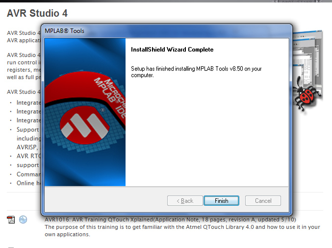
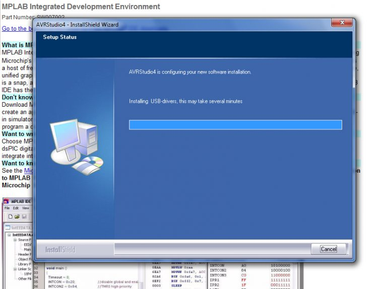

# Pic’s and Atmega’s …

*Document converti depuis [ve2cuy.com/blog](https://ve2cuy.com/blog/index.php/2010/06/02/pics-and-atmegas/) — publié le 2010-06-02 — dernière modification : 2010-06-02*

---

Just ordered a few atmel and microchip microcontrollers on eBay for some projects that I will do during summer vacation.  So, I had to install AVR Studio 4 and MPLAB tools 8.5.

Find the error on theses screen captures:

For a quick ‘cpp’ AVR-Studio start:   [c++ avr tutorial](http://imakeprojects.com/Projects/avr-tutorial/) by Donald Papp

For a quick ‘cpp’ MPLAB C18 C compiler start:  [MPLAB C18 Getting Started](http://ww1.microchip.com/downloads/en/DeviceDoc/MPLAB_C18_Getting_Started_51295f.pdf)
