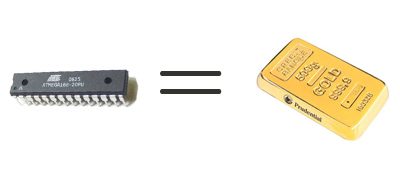

# Hold on to that pile of gold

*Document converti depuis [ve2cuy.com/blog](https://ve2cuy.com/blog/index.php/2010/06/03/hold-on-to-that-pile-of-gold/) — publié le 2010-06-03 — dernière modification : 2010-06-03*

---

For the last year, I have been using an Arduino board and the associated IDE to build a few projects around the Atmega328.

If you are willing to live with miner limitations; boot loader, hardware wrappers (timers, interrupts), …, it’s a very handy solution.

The only major annoyance is the scarceness of the Atmega328 or 168 chip!  Try to get one with DIP package at a reasonable price… It’s been out off stock for a while now at DigiKey (well I guess not anymore: [DigiKey](http://parts.digikey.com/1/parts/1561087-mcu-avr-32k-flash-28-pdip-atmega328p-pu.html), [Mouser](http://ca.mouser.com/Search/ProductDetail.aspx?qs=K8BHR703ZXguOQv3sKbWcg==))

I saw, on eBay, a seller that was asking 1,99USD + 8,50USD for shipping – for one Atmega328.  I said to myself, hum, it might be a good opportunity for 10 pieces.  So I asked the sealer.

Surprise! (well, not really), I got this:

—

**Dear aboudro,**

“For normal price of total price 10units(Atmega328) is $105 but for you that special price of total price 10units(Atmega328) is $85

Best regards,

**– m……**

—

Great, He gave me a special price on shipping, 65$ to send a 2 ounce package.  I felt so lucky.

Back to my story;

Atmel makes a lot of fine and available chips so I got myself an Atmel AVR ISP In-System Programmer and some ATTINY2313-20PU-ND.

Their IDE is a pleasure to work with and I like the idea of ‘in circuit programming’.

My next AVR project will be a frequency counter – on the local oscillator- with I.F. adjustment – for a vacuum tube, shortwave radio I am working on.  See this post: [Project 4 – SW tube receiver](Project-4-SW-tube-receiver.md).  It will be used to display the tuned station frequency.

I will start by using a *Hitachi* HD44780 compatible LCD display but I might switch to nixie tubes.

To be continued…
