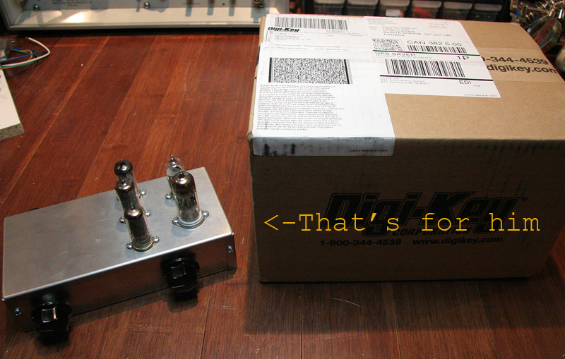
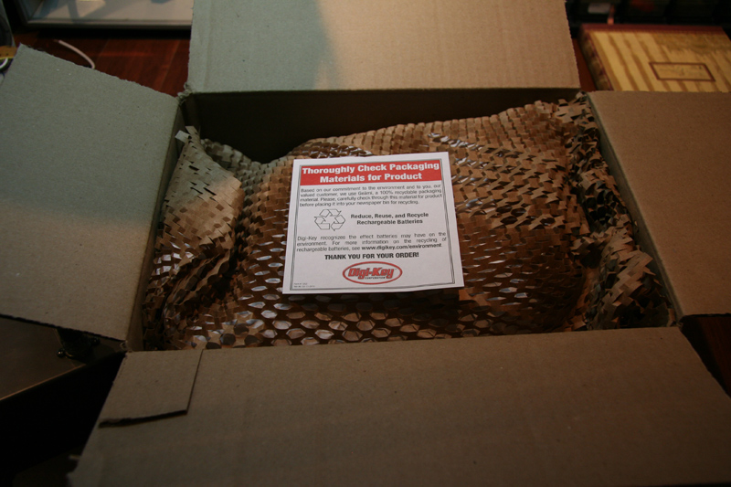
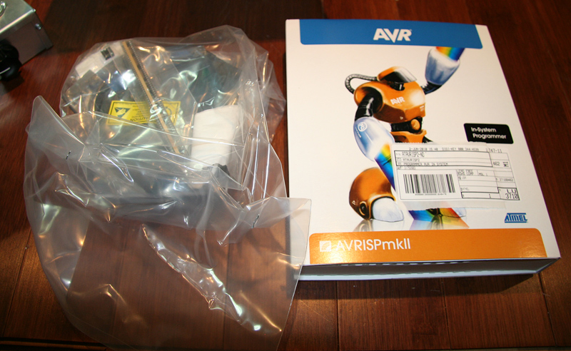
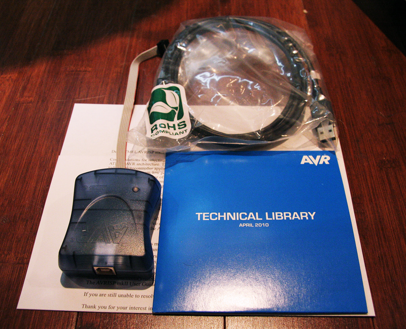
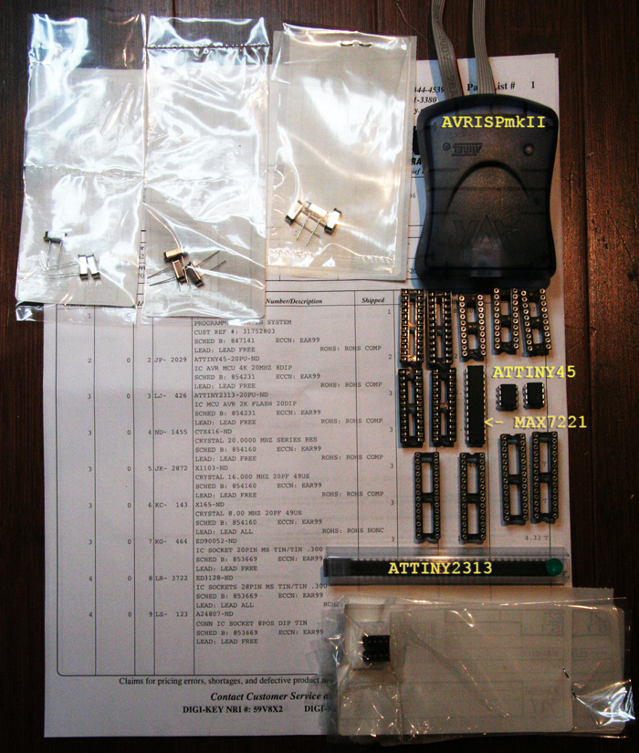
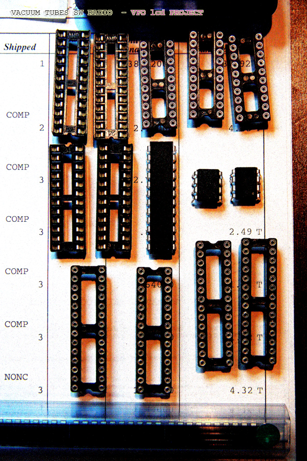

# When price is not worth your while

*Document converti depuis [ve2cuy.com/blog](https://ve2cuy.com/blog/index.php/2010/06/03/when-price-is-not-worth-the-wait/) — publié le 2010-06-03 — dernière modification : 2010-06-03*

---

When shipping time is not an issue, I usually order electronic parts from Asia.

But sometimes, you know, when you feel a project itch, I always order from DigiKey.

Why?

Fair prices but mainly, the service.  I don’t know how they do it but I ALWAYS receive my order, at my door, in less than 24 hours!

Thanks, Guys!

So, just got my AVRISPmkII and other stuff.

The unpacking:

And now, back to the project …
