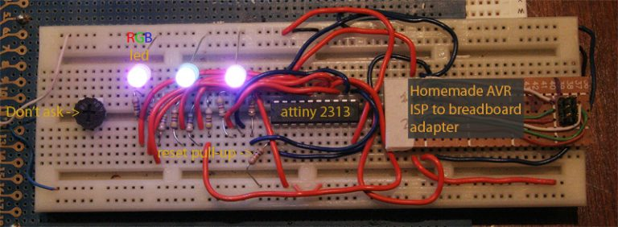

# Abyssus universitas

*Document converti depuis [ve2cuy.com/blog](https://ve2cuy.com/blog/index.php/2010/06/04/abyssus-universitas/) — publié le 2010-06-04 — dernière modification : 2010-06-04*

---

In the world of computer programming, the “Hello world program” is often the first one we write.  During my computer science Degree, we did it in Cobol, Pascal, Modula, 370 assembler, …

In the world of microcontroller, where a display device his rarely utilize in a first project, we light up a LED.

Even after years of playing around with cpu chips or microcontrollers, I still revisit that old classic.

There is something fascinating about staring at a flashing LED.

It must come from my youth, when I would stare at the vacuum tubes in the back of my parent’s b&w tv for hours. Yep, I’m that old…

So, back to the never ending project of lightening a LED.

After unwrapping the AVRISP mkII, I reproduced a “RGB led, PWM controlled” project from David Gustafik at <http://www.daqq.eu/index.php?show=prj_yabled>.

The idea here was to test the new acquired AVRISP mkII, not reinvent a way of saying “abyssus universitas”.

After a few adjustments in AVR Studio and transferring the HEX file to the chip, I caught myself staring, and staring, and staring, and … (ok, you get the point) at:

`▶️ Vidéo YouTube : [Voir la vidéo](https://www.youtube.com/watch?v=YiELwEK13aM)`  
I must admit, 9 channel software PWM is not the usual ‘Hello world’ program, but what the heck…

Farewell
