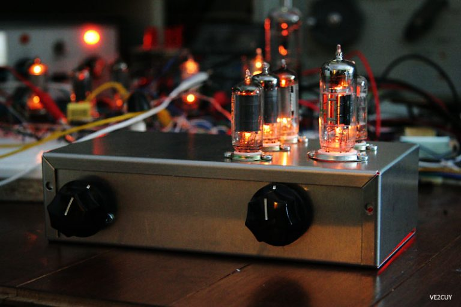

# Someday …

*Document converti depuis [ve2cuy.com/blog](https://ve2cuy.com/blog/index.php/2010/06/20/someday/) — publié le 2010-06-20 — dernière modification : 2010-06-20*

---

I’ve made some progress on my 5 tubes shortwave radio.

The frequency counter prototype is working.

I’m using a MPF102 as an RF amp, then the signal is feed in a 74HC161 (16x prescaler) and finally into an atmega328p for counting.

For a video goto:

`▶️ Vidéo YouTube : [Voir la vidéo](https://www.youtube.com/watch?v=Wd0NOFe4joQ)`

`Project 4 – Homemade SW vacuum tubes receiver`
