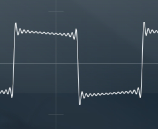
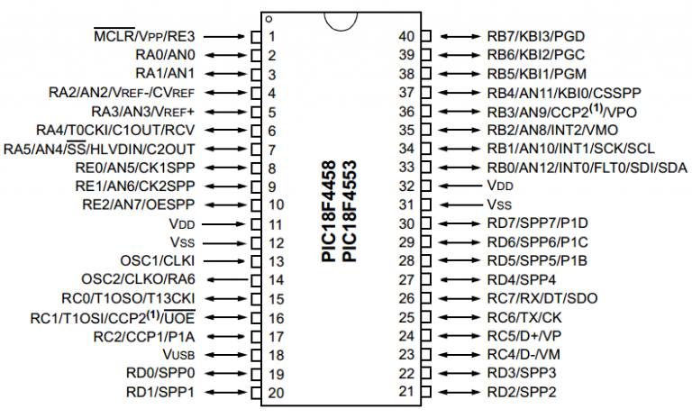
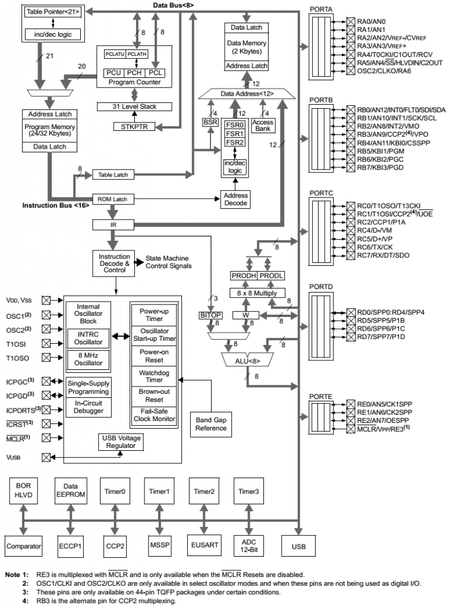
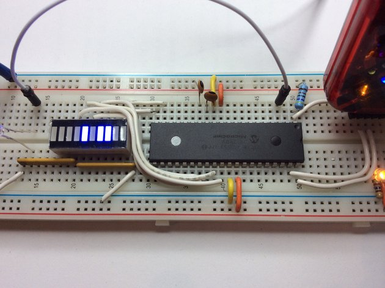
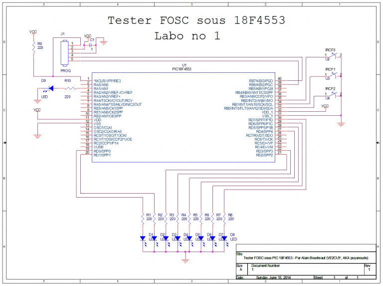
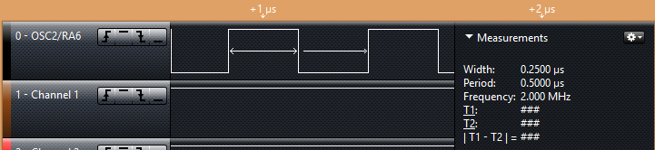
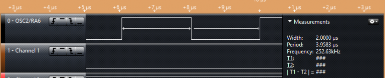
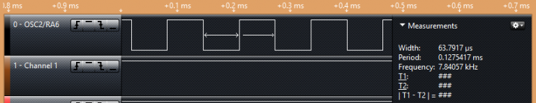

# Comment programmer l’horloge d’un PIC 18F

*Document converti depuis [ve2cuy.com/blog](https://ve2cuy.com/blog/index.php/2014/06/14/712/) — publié le 2014-06-14 — dernière modification : 2014-06-14*

---

# Mise en situation



Lorsque nous commençons nos premiers balbutiements avec les microcontrôleurs, un des premiers obstacles rencontrés est assurément le choix d’une source d’horloge de cadence du microcontrôleur ainsi que ses paramètres de configuration.

Pour les membres de la famille des PIC 18F, il y a quatre choix possibles pour cadencer la puce, soit à partir:

– d’un signal d’horloge externe,  
– d’un circuit oscillant RC (résistance/condensateur) externe,  
– d’un cristal externe,  
– ou de l’horloge interne du microcontrôleur.

Dans les montages effectués par les bricoleurs maisons, le choix se situe habituellement entre l’horloge interne et le cristal externe.

# L’horloge interne du PIC 18F

Le PIC 18F4553 possède une horloge interne qui peut être utilisée pour cadencer ce dernier. C’est une solution économique – pas de pièces supplémentaires à ajouter au montage – qu’on utilisera si une valeur maximale de 8 MHZ convient et qu’une imprécision d’environ +- 2% de la fréquence n’aura pas d’impact sur le système.

L’horloge interne offre les cadences suivantes :

```
8 MHz – (111) *
4 MHz – (110)
2 MHz – (101)
1 MHz – (100)
500 kHz – (011)
250 kHz – (010)
125 kHz – (001)
31.25 kHz – (000)
```

**tableau 1**

\* Les valeurs entre parenthèses seront utilisées dans nos programmes pour renseigner la vitesse de l’horloge interne.

# Comment programmer l’horloge interne du PIC 18F4553?

La source de l’horloge – interne, cristal, RC … – est sélectionnée via les bits de configuration **FOSC (fréquence de l’oscillateur)**.

La façon la plus simple, sous MPLAB X IDE et XC8, est d’utiliser la directive de compilation suivante dans notre programme :

```
#pragma config FOSC = INTOSC_EC
```

Sans autre configuration, le microcontrôleur sera cadencé à 8 MHz par l’horloge interne du PIC.

De plus, la fréquence de l’oscillateur divisée par 4 (**Fosc/4**) sera présentée à la broche 14 (**OSC2/CLK0/RA6**) du PIC.

Cela sera utile pour prendre des lectures de fréquences lors de nos expérimentations.

*Note: Le PIC 18F exécute ses instructions en quatre (4) cycles d’horloge. Fosc/4 permet donc de synchroniser les circuits externes avec la cadence d’exécution d’une instruction.*

## Plan des broches (Pin-out) du PIC 18F4553



**Image 1**

## Le diagramme de bloc du PIC 18F4553



**Image 2**

# Préparons le montage suivant



**Image 3**

Note: Les deux condensateurs, sur l’image précédente,  serviront au Labo avec un cristal externe.



**Image 4**

# Le code source

```cpp
/*
 * Project: Tester l'horloge interne du 18F4553 sous MPLAB X IDE v2.10 et XC8
 * Auteur:  Alain Boudreault
 * Date:    2014.06.14
 * -----------------------------------------------------------------------------
 * Description:
 *
 * Le but de ce projet est de tester toutes les combinaisons de IRCFn
 * pour faire varier la vitesse de l'horloge interne et
 * de mesurer fz/4 sur OSC2.
 *
 * Des LEDs, sur PORTD, sont utilisés comme rétroaction visuelle
 * aux changements de la vitesse.
 *
 * La plage horloge s'étend de 31.25 kHz à 8 MHz.
 *
 * Le PORTB - 3 bits seront requis - est utilisé en entrées
 * pour composer les valeurs possibles.
 *
 * Ce port a l'avantage d'avoir des résistances pull-UP internes ce qui
 * allège le montage physique.
 *
 * Pour activer les pull-UP:  RBPU = 0;
 *
 * Il est possible d'ajuster finement la fréquence d'horloge avec OSCTUNE
 *
 *  011111 Fréquence maximale
 *  000000 Fréquence centre
 *  111111
 *  100000 Fréquence minimum
 *  Par exemple,  OSCTUNE = 0b00000111;
 *
 */

#include "pic18F4553.h"

#define LED_TRIS  TRISAbits.TRISA1
#define LED_PIN   PORTAbits.RA1

#define LECTURE0   PORTBbits.RB0
#define LECTURE1   PORTBbits.RB1
#define LECTURE2   PORTBbits.RB2

#define VITE    0b01110000
#define LENT    0b00000000
#define ENTREE  1
#define SORTIE  0
#define END_OF_TIME 1

#pragma config FOSC = INTOSC_EC     // Horloge interne avec fz/4 sur OSC2
#pragma config PBADEN = OFF         // PORTB<4:0> broches configurées en digital I/O sur Reset

unsigned char i = 0;

void delay() {
    long int counter = 0;
    for (counter = 0; counter<500; counter++) {  asm("NOP");   }
} // delay

void main(void) {

    TRISC0 = SORTIE;
    TRISD = 0;          // LEDs pour la rétroaction visuelle
    LED_TRIS = 0;

    // Activer les pull-up du PORTB
    RBPU = 0;

    while (END_OF_TIME) {

         // Ajuster la vistesse de l'horloge en fonction des pins de configuration
         OSCCONbits.IRCF0	= !LECTURE0;
         OSCCONbits.IRCF1	= !LECTURE1;
         OSCCONbits.IRCF2	= !LECTURE2;

         // Allumer le LED témoin si vitesse horloge >= 1 MHz
         if (!LECTURE2 == 1 )
            LED_PIN = 1;
         else
            LED_PIN = 0;

        // Afficher la séquence des LEDs témoins
        PORTD = i++;
        delay();
    } // while
} // main()
```

# Explications du code

```css
À suivre ...
```

---

# Résultats du montage

## Lecture de la broche 14 – OSC2/CLK0/RA6:

**Test 1 – Le montage est sous tension et les broches Rb0, RB1 et RB2 sont connectées à VDD (ground).**

Note: Le programme va inverser l’état de ces broches, par exemple, !LECTURE0.

Pourquoi procéder ainsi?  Parce que nous utilisons les ‘pull-up’ internes du PORTB.  La valeur par défaut des broches du PORTB est donc à logique ‘1’.  Pour changer l’état, il faut donc passer à logique ‘0’.

Donc, nous obtiendrons 111 comme valeur de lecture pour RB:2..0.

Avec**IRCF:111 = Fosc/4 = 2mHz**



**Image 5**

**Résultat:**

Le PIC est cadencé à **8mHz**, il exécute **2 millions d’instructions par seconde** et une impulsion cadencée à **2mHz** est présente à la broche **RA6**.

---

**Test 2 – Le montage est sous tension et seulement la broche RB2 est connectée à VDD (ground).**

Avec**IRCF:100 = Fosc/4 = 252.63kHz**



**Résultat:**

Le PIC est cadencé à 1mHz (lecture réelle à 1.01mHz – souvenez-vous de l’imprécision de +- 2%), il exécute 252 milles instructions par seconde et une impulsion cadencée à 252kHz est présente à la broche RA6

---

**Test 3 – Le montage est sous tension et aucune broche n’est connectée à VDD (ground).**

Avec**IRCF:000 = Fosc/4 = 7.84kHz**



**Résultat:**

Le PIC est cadencé à 32.5kHz, il exécute 7800 instructions par seconde et une impulsion cadencée à 7.8kHz est présente à la broche RA6

---

Voici le résultat vidéo du projet avec changement en temps réel de **Fosc** en faisant varier la valeur des broches **33- RB0,  34 – RB1 et 35 -RB2**

▶️ Vidéo YouTube : [Voir la vidéo](https://www.youtube.com/watch?v=WaoQdw7j-qM)

Référence Microchip – [18F4553](http://ww1.microchip.com/downloads/en/DeviceDoc/39887c.pdf), [18F4550](http://ww1.microchip.com/downloads/en/DeviceDoc/39632e.pdf)

---

Article rédigé par Alain Boudreault (aka:VE2CUY, aka:puyansude) 2014.06.15
