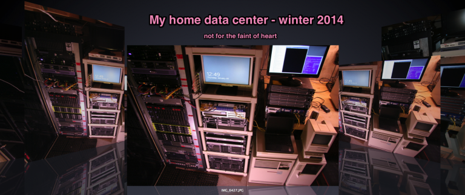

# My home data center

*Document converti depuis [ve2cuy.com/blog](https://ve2cuy.com/blog/index.php/2014/06/14/my-home-data-center/) — publié le 2014-06-14 — dernière modification : 2014-06-14*

---

For those of you who like hardware, I’ve documented my home data center.

So what kind of testing goes on here?

- Hardware:  enterprise class servers – Dell, HP, IBM –  SAS, RAID 5, 6 + spare, RAID 50, 60, hot swap, UPS, F.C. SAN, Fibre switch, tape backup (IBM LTO3), …
- OS – Linux, Windows, OpenVMS, z/OS, HP-UX, IBM AIX, …
- Virtualization – VMware vSphere Hypervisor, vCenter server, vMotion, openStack, Xen, …
- Network – switch, CLI, LACP, MSTP, ACL, topology, fiber optic, vlan, firewall, traffic shaper, trust and untrust LAN, IPV6, …
- VOIP – Asterisk, VOIP, POE (Dell powerConnect 3448P), IP phones (Nortel 1230), SIP, …
- And much more …

[Enjoy your tour in my home data center!](My-home-data-center.md)
