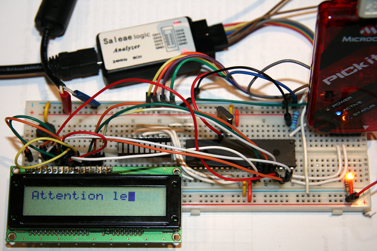

# PIC 18F – Exemple pour afficher sur LCD avec plib/xlcd.h

*Document converti depuis [ve2cuy.com/blog](https://ve2cuy.com/blog/index.php/2014/08/02/pic-18f-exemple-pour-afficher-sur-lcd-avec-plibxlcd-h/) — publié le 2014-08-02 — dernière modification : 2014-08-02*

---

Sample code that displays on a LCD using the xlcd XC8 library

Note: The internal clock is used with the default clock rate of 1 MHz.

———————————————————————————————–

Voici un exemple de code qui permet d’afficher sur un LCD en utilisant la librairie xlcd sous xc8

Note: L’horloge interne est utilisée avec la cadence par défaut (1 Mhz).

#### Directives de connexions

| LCD | PIN | PIC | PIN |
| --- | --- | --- | --- |
| RW | 5 | RB6 | 39 |
| RS | 4 | RB5 | 38 |
| E | 6 | RB4 | 37 |
| D4 | 11 | RB0 | 33 |
| D5 | 12 | RB1 | 34 |
| D6 | 13 | RB2 | 35 |
| D7 | 14 | RB3 | 36 |



 Référence [LCD](http://www.studentcompanion.co.za/post/2013/05/21/Interfacing-LCD-Display-With-PIC-Microcontroller-XC8)

```cpp
/*
* Info sur le LCD: http://www.studentcompanion.co.za/post/2013/05/21/Interfacing-LCD-Display-With-PIC-Microcontroller-XC8
* -----------------------------------------------------------------------------
* Description: Afficher sur le LCD en utilisant plib/xlcd.h
* -----------------------------------------------------------------------------
* Directives de connexions du PIC avec le LCD:
*
* Ce projet utilise les valeurs par défaut de plib/xlcd.h sur BUS 4 bits
*
* LCD PIN PIC PIN
* RW  5   RB6 39
* RS  4   RB5 38
* E   6   RB4 37
*
* DATA sur 4 bits
* LCD PIN PIC PIN
* D4  11  RB0 33
* D5  12  RB1 34
* D6  13  RB2 35
* D7  14  RB3 36
*/

#include <xc.h>
#include <plib/xlcd.h>

#pragma config FOSC = INTOSC_EC  // Utilisation de l'OSC interne avec vitesse par defaut (1Mhz)
#pragma config LVP = 0;          // LCD ne fonctionne pas avec ce bit à ON! Quelqu'un peut expliquer pourquoi?
#define _XTAL_FREQ 1000000       // Constante requise pour __delay_ms()
#define END_OF_TIME 1
#define LINE_2 0x40

// ***************************************************
// Prototypes des fonctions locales au projet
// ***************************************************
void init_XLCD(void);
void cls(void);
void DelayFor18TCY(void);
void DelayPORXLCD(void);
void DelayXLCD(void);
void uneDemieSeconde(void);
void afficherMsgAvecDelai(char * msg[], int sec, int position);

// ***************************************************
void main(void) {
// ***************************************************
 TRISD = 0;

 init_XLCD();

 afficherMsgAvecDelai("Attention le", 1, 0);
 afficherMsgAvecDelai("spectacle ", 1, LINE_2);
 afficherMsgAvecDelai("debute NOW! ", 3, 0);
 cls();

 while (END_OF_TIME) {
   PORTD = 0xFF;
   afficherMsgAvecDelai("Je suis le ", 1, 0);
   afficherMsgAvecDelai("message du jour", 1, 0);
   afficherMsgAvecDelai("** Be happy! **", 2, LINE_2);
   PORTD = 0x00;
   uneDemieSeconde(); //delay();
   cls();
 } // while END_OF_TIME
} // main()

// ***************************************************
// Fonctions locales au projet

// ***************************************************
void init_XLCD(void)
// ***************************************************
{
 OpenXLCD(FOUR_BIT&LINES_5X7); // configure LCD: 4-bit, 5x7char, multi-lines
 while(BusyXLCD());            // Wait until LCD !busy
 WriteCmdXLCD(0x06);           // cursor right, don't shift display
 WriteCmdXLCD(0x0C);           // display on without cursor
 } // init_XLCD

// ***************************************************
void cls(void){
// ***************************************************
 while(BusyXLCD());  //Check if the LCD controller is not busy
 WriteCmdXLCD(0x01); // Clear LCD
} // cls

// ***************************************************
void uneDemieSeconde(void){
// ***************************************************
 for (int i=0;i<10;i++)
   __delay_ms(50);
} // uneDemieSeconde

// ***************************************************
void afficherMsgAvecDelai(char * msg[], int sec, int position) {
// ***************************************************
 while(BusyXLCD());
 SetDDRamAddr(position);
 while(BusyXLCD());
 putrsXLCD( msg );
 while(BusyXLCD());
 for (int i = 0 ; i<sec; i++) {
   uneDemieSeconde();
 }
} // afficherMsgAvecDelai

// ***************************************************
// Implémentation des routines de délais pour plib/xlcd.h
// Note: Il faut définir la constante suivante:
// #define _XTAL_FREQ 8000000 // Note: 8mg est un exemple

// ***************************************************
void DelayFor18TCY(void)
{ __delay_us(36); // Value of '18' did not work for me!
}

// ***************************************************
void DelayPORXLCD(void)
{ __delay_ms(15); }

// ***************************************************
void DelayXLCD(void)
{ __delay_ms(5); }
```
