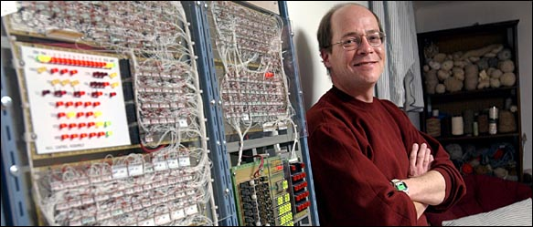

# Apollo Guidance Computer

*Document converti depuis [ve2cuy.com/blog](https://ve2cuy.com/blog/index.php/2014/08/11/ordinateur-de-controle-module-datterrissage-du-agc/) — publié le 2014-08-11 — dernière modification : 2021-04-29*

---

One of my favorite projects:

Reconstruction of the ‘Apollo Guidance Computer’.

John Pultorak did an extraordinary job.

———————————————————————-

Un de mes projets préférés:

Reconstitution du ‘Apollo Guidance Computer’.

John Pultorak a fait un travail extraordinaire.

———————————————————————-

Documents:

[build_agc_1](fichiers/build_agc_1.pdf)  
[build_agc_2](fichiers/build_agc_2.pdf)  
[build_agc_3](fichiers/build_agc_3.pdf)  
[build_agc_4](fichiers/build_agc_4.pdf)  
[build_agc_5](fichiers/build_agc_5.pdf)  
[build_agc_6](fichiers/build_agc_6.pdf)  
[build_agc_7](fichiers/build_agc_7.pdf)  
[build_agc_8](fichiers/build_agc_8.pdf)  
[build_agc_9](fichiers/build_agc_9.pdf)
