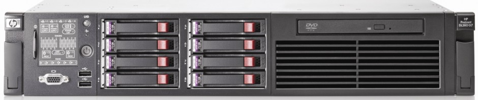

# A new DL380 G7 in the data center

6 months ago, I have added to my data center a new HP DL380 G7 server.

A superb machine with 2x 6 cores CPU which gives 24 virtual cores, 32GB of DDR3 RAM and 6x SAS 10k 300gb disk .

Soon, I will move the Asterisk and pfSense vmware machines to this server, in addition to some experimental virtual machines : Windows 10, centos and OpenStack.

To be continued …
