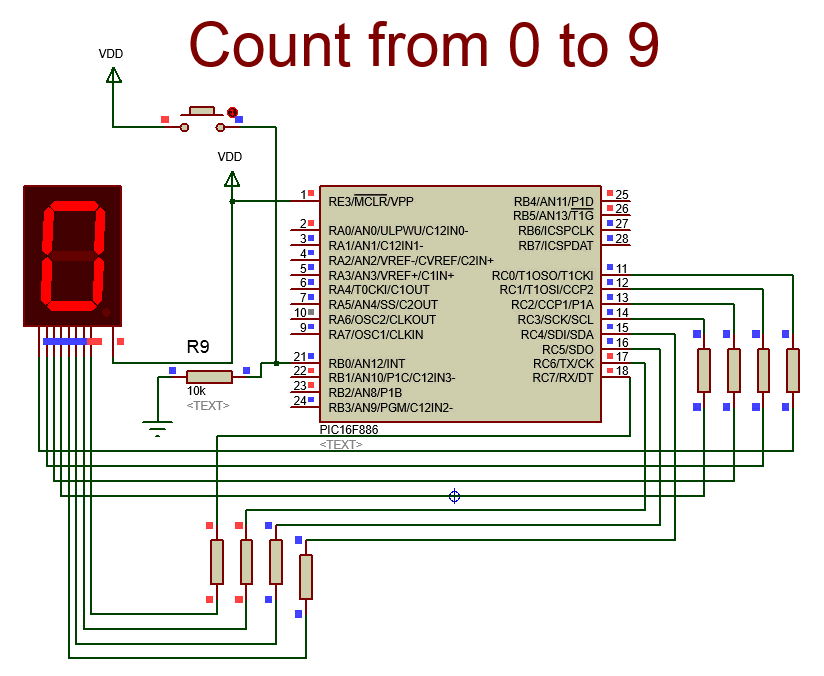

# Watch the dog watch the watchdog

*Document converti depuis [ve2cuy.com/blog](https://ve2cuy.com/blog/index.php/2015/03/31/watch-the-dog-watch-the-watchdog/) — publié le 2015-03-31 — dernière modification : 2015-03-31*

---

### What’s wrong with this picture?

Here, we have a classic example of a PIC being reset by its watchdog timer.

The PIC used in the simulation – 16F866 – has a default watchdog countdown timer of about 2.3 seconds.

So, the count from 0 to 9 is interrupted before the end of the sequence and the program is restarted.

In the following article, we will see how to configure and use a watchdog on a PIC micro-controller.

[Read the article](Understanding-the-PIC-16F-watchdog.md)
