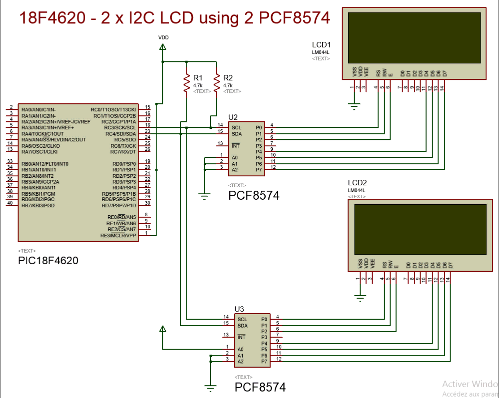

# PIC 18F – I2C LCD display using a PCF8574

# Display on 2 LCD, using 2 PCF8574 and a PIC 18F4620

See how to display on 2 Hitachi HD44780 with PCF8574 using the I2C protocol.

Read the [article](18F4620-2-x-I2C-LCD-with-PCF8574.md)
