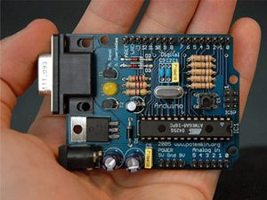
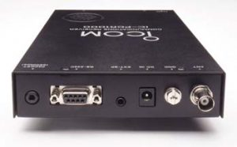
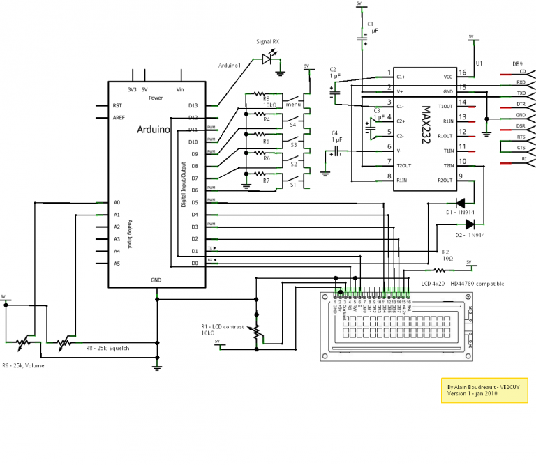

# Arduino

*Document converti depuis [ve2cuy.com/blog](https://ve2cuy.com/blog/index.php/arduino/) — dernière modification : 2010-01-03*

---

What can we do with  Arduino and a icom PCR-1000?

+

=

.

.

A PC free PCR-1000.

▶️ Vidéo YouTube : [Voir la vidéo](https://www.youtube.com/watch?v=yiwWAVxGsgw)

.

I have posted this project on

<http://www.arduino.cc/playground/Main/InterfacingWithHardware>

Sketch available here: [PCR1000Ver6.rar](https://github.com/puyansude/pcr1000v6/blob/master/PCR1000Ver6.rar)

**Circuit diagram:**

=========================

PCR1000.PDE

=========================

> // Project:     Arduino PCR1000 crtl program  
> // By:          VE2CUY – Alain Boudreault  
> // web:         [Accueil](../README.md)  
> // Version:     2009.12.29  
> // Preliminary  release  
> // —————————————————  
> // If you use this program, please leave this section.  
> // —————————————————
>
> // Note: copy the PCR1000 folder to the arduino ‘libraries’
>
> …
