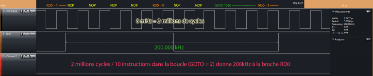
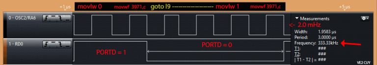
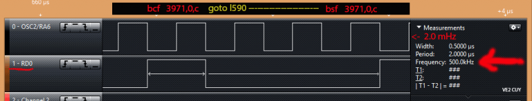

# Calculer le temps d’exécution d’une instruction sous PIC 18F

*Document converti depuis [ve2cuy.com/blog](https://ve2cuy.com/blog/index.php/calculer-le-temps-dexecution-dune-instruction-sous-pic-18f/) — dernière modification : 2015-03-28*

---

# Mise en situation

**Étant donné la boucle suivante:**

```cpp
Start:
         PORTD = 1
         PORTD = 0
AllerA   Start
```

*Quel sera la fréquence présentée à la broche RD0?*

Si nous connaissons la fréquence de Fosc et le nombre de cycles requis pour exécuter une instruction alors cela ne devrait être qu’un simple exercice de mathématique…



# Petit rappel

Les microntroleurs PIC de la famille 18F exécutent une instruction en 4 cycles d’horloge. Il y a des exceptions comme par exemple, l’instruction ‘goto’ qui doit lire l’adresse de destination sur 4 octets, ce qui nécessite 8 cycles d’horloge.

Pour simplifier la démonstration, disons que toutes les instructions sont exécutées en 4 (4 hz) cycles d’horloge.

Si notre PIC a une fréquence d’oscillateur (**Fosc**) de 8mHz alors 8 000 000 / 4 permet de calculer le nombre d’instructions à la seconde.

Ici, cela donne 2 millions d’instructions à la seconde. Ou si vous préférez, 2 MIPS.

Certains modes de configuration de l’horloge permettent de présenter **Fosc/4** sur la broche **OSC2** du PIC.

# Directives

Pour ce labo, nous utiliserons le montage présenté [ici](images/Calculer-le-temps-d-execution-d-une-instruction-sous-PIC-18F/labo_01.png), avec l’horloge interne programmée à 8mHz:

```cpp
#pragma config FOSC = INTOSC_EC
#define VITESSE_8MHZ 0b01110000
...
OSCCON = VITESSE_8MHZ;
```

---

# Code source du projet

```cpp
/*
* Project: Tester l'horloge interne du 18F4553 sous MPLAB X IDE v2.10 et XC8
* Labo: 02
* Auteur: Alain Boudreault
* Date: 2014.06.15
* -----------------------------------------------------------------------------
* Description:
*
* Le but de ce projet est de tester le temps d'exécution des instructions
* du PIC
*
* le PORTD.RD0 sera utilisé pour produire un signal qui sera
* par la suite mesuré grace à un scope digital.
* -------------------------------------------------------------------
* Test no 1: Horloge interne à 8mhz
* Boucle sur PORTD.RD0, on/off en utilisant tout PORTD
*
* PORTD = ON;
  PORTD = OFF;

61 007FF6 l9:
62
63 ;main.c: 52: PORTD = 1;
64 007FF6 0E01 movlw 1
65 007FF8 6E83 movwf 3971,c ;volatile
66
67 ;main.c: 54: PORTD = 0;
68 007FFA 0E00 movlw 0
69 007FFC 6E83 movwf 3971,c ;volatile
70 007FFE D7FB goto l9
*
* -------------------------------------------------------------------
* Test no 2: Horloge interne à 8mhz
* Boucle sur PORTD.RD0, on/off en utilisant PORTDbits
*
* PORTDbits.RD0 = ON;
  PORTDbits.RD0 = OFF;

61 007FFA l9:
62
63 ;main.c: 52: PORTDbits.RD0 = 1;
64 007FFA 8083 bsf 3971,0,c ;volatile
65
66 ;main.c: 53: PORTDbits.RD0 = 0;
67 007FFC 9083 bcf 3971,0,c ;volatile
68 007FFE D7FD goto l590
* -------------------------------------------------------------------
* Test no 3: Horloge interne à 8mhz
* Boucle sur PORTD.RD0, on/off en utilisant PORTDbits et
* des NOP
61 007FEE l590:
62
63 ;main.c: 64: PORTDbits.RD0 = 1;
64 007FEE 8083 bsf 3971,0,c ;volatile
65 007FF0 F000 nop ;#
66 007FF2 F000 nop ;#
67 007FF4 F000 nop ;#
68 007FF6 F000 nop ;#
69
70 ;main.c: 69: PORTDbits.RD0 = 0;
71 007FF8 9083 bcf 3971,0,c ;volatile
72 007FFA F000 nop ;#
73 007FFC F000 nop ;#
74 007FFE D7F7 goto l590

*
*/

#include "pic18F4553.h"

#define test01
//#define test02
//#define test03

#define ON 1
#define OFF 0
#define END_OF_TIME 1
#define SORTIE 0
#define VITESSE_8MHZ 0b01110000
#pragma config FOSC = INTOSC_EC // Horloge interne avec fz/4 sur OSC2

void main(void) {
TRISD = SORTIE; // Broche pour le mesure de fréquence
OSCCON = VITESSE_8MHZ; // Renseigner l'horloge à 8mHz
while (END_OF_TIME) {

// Test01 - Écriture sur le PORTD complet
#ifdef test01
PORTD = ON;
PORTD = OFF;
#endif

// Test02 - Écriture sur seulement un bit du PORTD
#ifdef test02
PORTDbits.RD0 = ON;
PORTDbits.RD0 = OFF;
#endif

// Test03 -
#ifdef test03
PORTDbits.RD0 = ON;
asm("NOP");
asm("NOP");
asm("NOP");
asm("NOP");
PORTDbits.RD0 = OFF;
asm("NOP");
asm("NOP");
#endif

} // while
} // main()
```

---

### Test 01 – Écriture sur le PORTD

```cpp
#define test01
#ifdef test01
        PORTD = ON;
        PORTD = OFF;
#endif
```

Le compilateur produira le code assembleur suivant:

```cpp
007FF6 l9:

007FF6 0E01 movlw 1       ; PORTD = 1
007FF8 6E83 movwf 3971,c

007FFA 0E00 movlw 0       ; PORTD = 0
007FFC 6E83 movwf 3971,c

007FFE D7FB goto l9
```

**Note: il est important de le consulter si nous voulons connaitre le nombre d’instructions de notre programme.**

Résultat au scope digital



### Explications

Le premier canal du scope digital présente le signal présent à la broche **OSC2**, donc **Fosc/4**.  Chaque **cycle** de ce signal représente le temps requis pour exécuter une instruction.  Notre programme comporte 5 instructions + 1 (goto).

Il faut donc 6 **cycles** pour compléter la boucle ou 24hz (6\*4) impulsions de Fosc.

Les deux (2) premiers **cycles** du graph représente le temp requis pour renseigner PORTD à 0.

Les quatre (4) suivants, le temps requis pour retourner au début de la boucle puis renseigner PORTD à 1.

Le signal présent sur RD0 est de 333.33kHz avec un duty cycle de 25%.

La valeur de lecture du signal de RD0 permet de calculer la vitesse d’horloge du PIC:

333.33k \* 6 instructions \* 4 cycles =  8mHz.

La boucle est exécutée en 6 instructions \* 4 **cycles** / 8mHz = 0,000003 sec (3 uSec)

À une vitesse d’horloge de 8mhz, nous pouvons conclure qu’une instruction est exécutée en 0,5 uSec.

---

### Test 02 – Écriture sur seulement un bit du PORTD

```cpp
#define test02
#ifdef test02
        PORTDbits.RD0 = ON;
        PORTDbits.RD0 = OFF;
#endif
```

Résultat au scope digital  



### Explications

À venir…

---

### Test 03 – Insertion de  NOPs, pour obtenir un rapport 0/1 de 50% (duty cycle)

```cpp
#ifdef test03
       PORTDbits.RD0 = ON;
       asm("NOP");
       asm("NOP");
       asm("NOP");
       asm("NOP");
       PORTDbits.RD0 = OFF;
       asm("NOP");
       asm("NOP");
#endif
```

Résultat au scope digital


### Explications

À venir…
