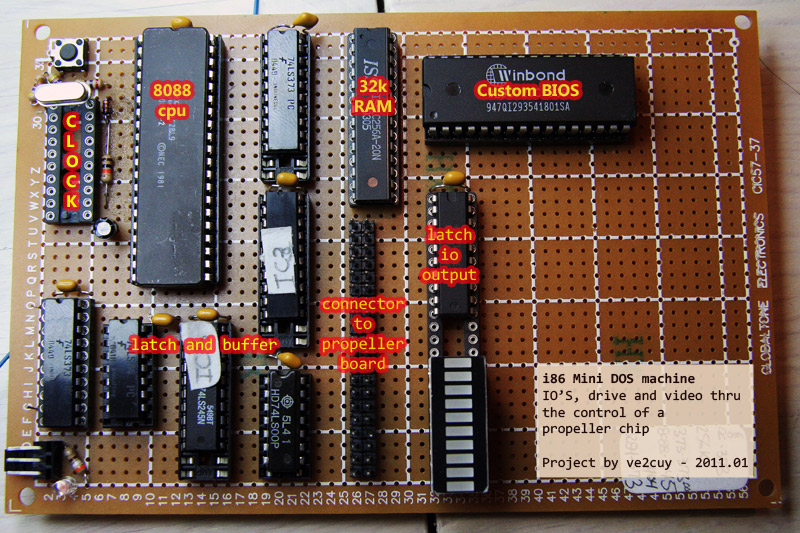
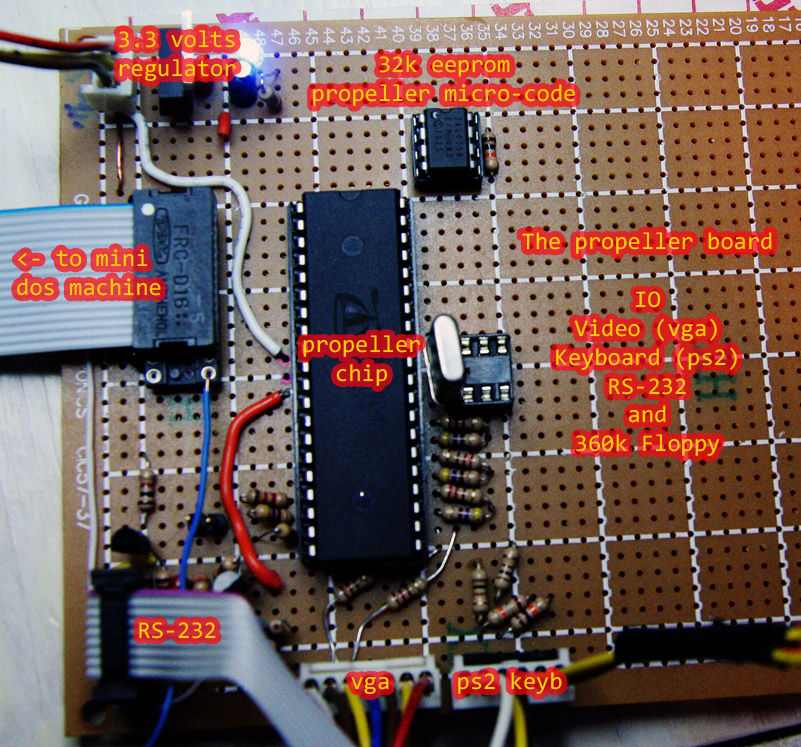
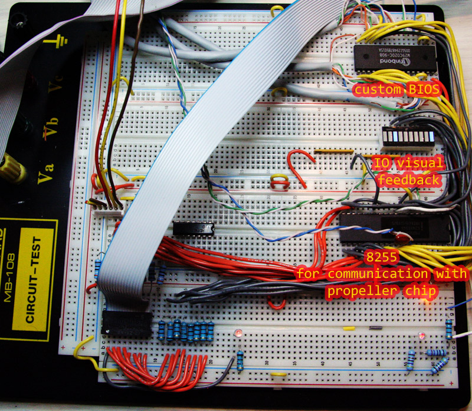
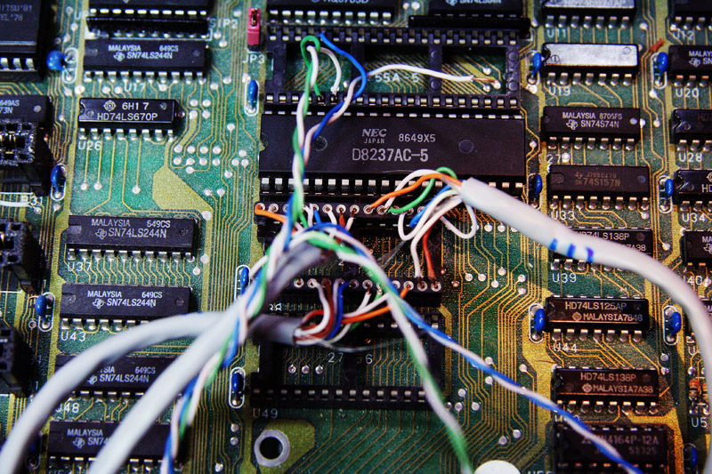
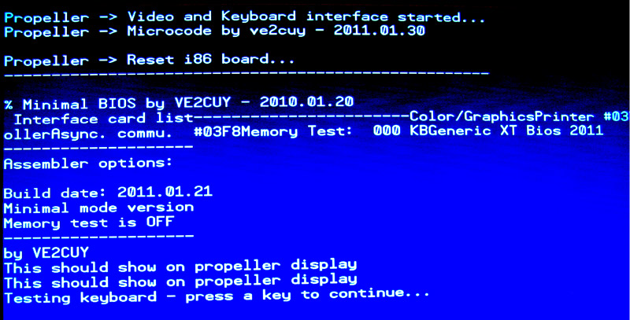
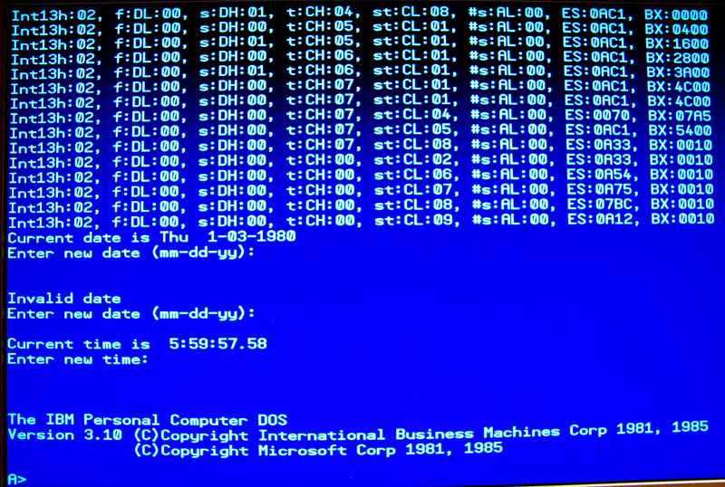

# Mini Dos machine

*Document converti depuis [ve2cuy.com/blog](https://ve2cuy.com/blog/index.php/mini-dos-machine/) — dernière modification : 2014-01-31*

---

I am (was) currently working on a mini i86 DOS machine.

An old modified PC-XT board serve as a test platform for the homemade BIOS.

All IO’s – keyboard, VGA Display, floppy disk, RS232 will be handle by a propeller chip board.

To date,

INT10 (video) and  
INT 16 (keyboard) are working.

I am currently working on INT13 (disk) function.

An image disk of DOS 3.1 will be on a SD flash drive connected to the propeller chip.

To date, with INT13 AH=02 (read); sector 0, side 0, track 0, I am able to load DOS boot sector from the propeller chip.

Some pictures:

Video at:

▶️ Vidéo YouTube : [Voir la vidéo](https://www.youtube.com/watch?v=qCj2deCFMnc)

Extract of propeller keyboard micro-code:

> PRI sendKey(request) | dataToSend
>
> dataToSend := 0                        ‘ DATA to return to the 8088
>
> if request == KEYB_AVAILABLE  
> if kb.gotkey  
> dataToSend := kb.keyNoRetrieve
>
> if request == KEYB_GET_KEY  
> dataToSend :=  kb.getkey
>
> outa[15..8] := dataToSend
>
> outa[DATA_AVAILABLE_FOR_8088] := 1  
> waitcnt(Delay_on + cnt)                                    ‘ Wait a moment so the 8088 has time to read it
>
> outa[8..15] := 0  
> outa[DATA_AVAILABLE_FOR_8088] := 0  
> waitcnt(Delay_off + cnt)
>
> return 0

Extract of Mini DOS Machine BIOS:

> ; Project:   MINI DOS MACHINE BIOS  
> ; Auteur:   Alain Boudreault (VE2CUY)  
> ; Date:    2010.01.10  
> ;——————————————————————————–
>
> .code  
> ORG     0h
>
> start: jmp  cold  
> include data.inc  
> COLD:   MOV     AX,40h  
> MOV     DS,AX  
> MOV     Word ptr DS:72h,0
>
> WARM:
>
> include cpu_test.asm
>
> JZ      CPU_OK  
> HALT:   HLT
>
> CPU_OK:
>
> include init_8xxxChips.asm  
> include Get_MemSize.asm  
> include Install_int_vectors.asm  
> ifdef  INST_BASIC_ROM  
> include Inst_Basic_Rom.asm  
> endif
>
> include Check_Devices.asm
>
> …
