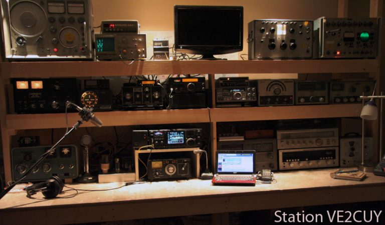
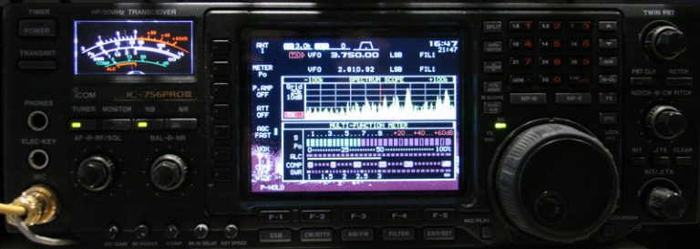
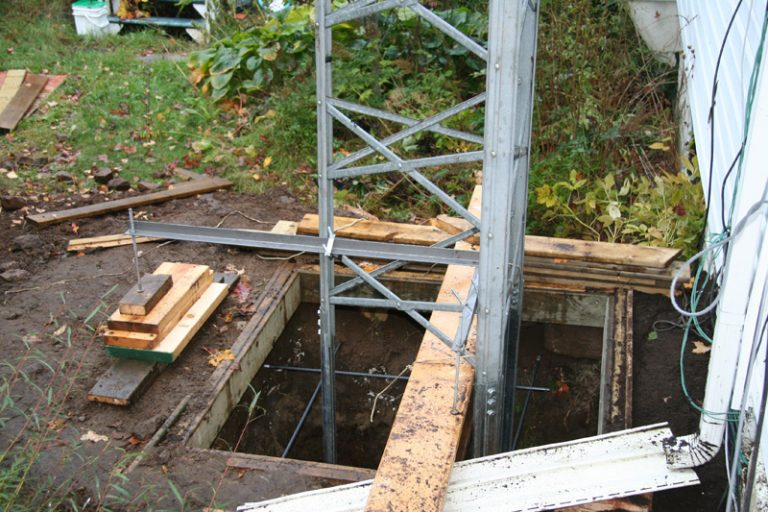
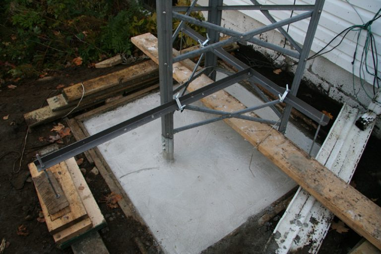
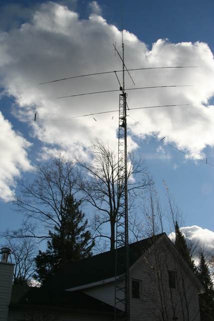

# My shack

*Document converti depuis [ve2cuy.com/blog](https://ve2cuy.com/blog/index.php/amateur-radio/) — dernière modification : 2010-01-03*

---

My first contact with wireless communication was a crystal radio that my father gave me for Christmas.  I was 10.

Then the usual progression; scanner, SW listener, Ham radio band listener.

I got my first HAM Radio license in 1989.

My preference is HF, usually voice on 80 and 20 meter band.

This is my station:

1 – **Inside**

My main transceiver:

2 – **Outside**

