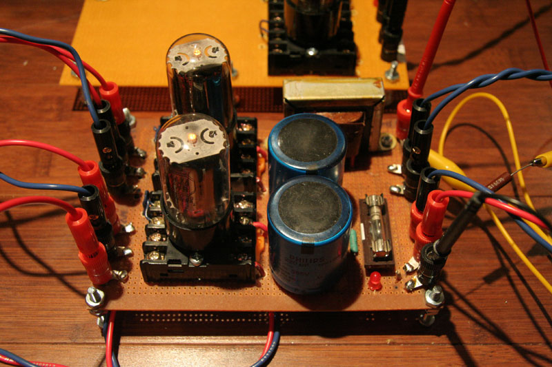

# Project 1 – 350 volt PS

Here is a power supply project build around 2 6AX4 in full bridge rectification.

This P.S. can handle 350 volt at 150 ma.

A L.E.D. is connected to the B+ via a 100k resistance.

