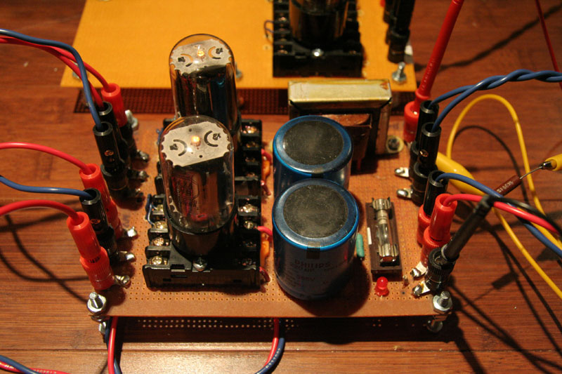

# Project 1 – 350 volt PS

*Document converti depuis [ve2cuy.com/blog](https://ve2cuy.com/blog/index.php/vacuum-tube/350-volt-ps/) — dernière modification : 2010-05-23*

---

Here is a power supply project build around 2 6AX4 in full bridge rectification.

This P.S. can handle 350 volt at 150 ma.

A L.E.D. is connected to the B+ via a 100k resistance.

