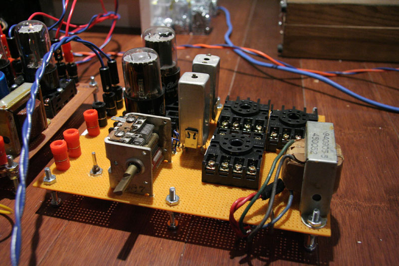
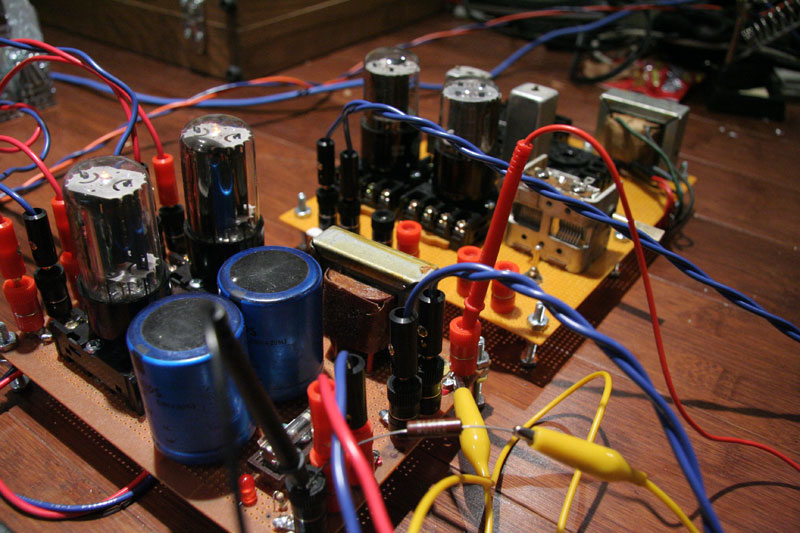
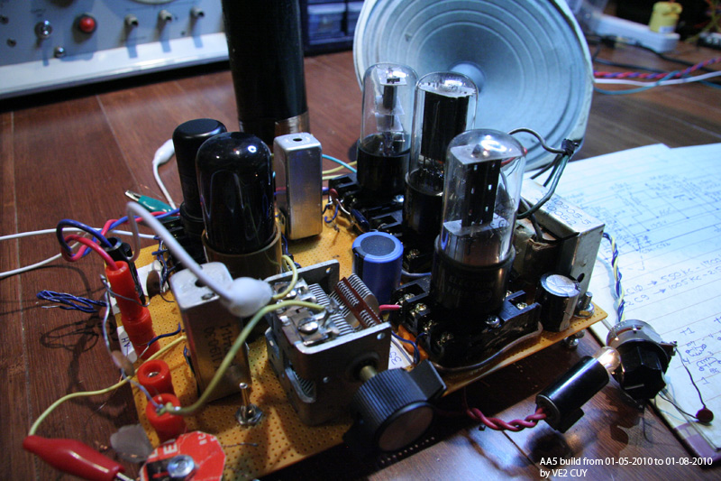
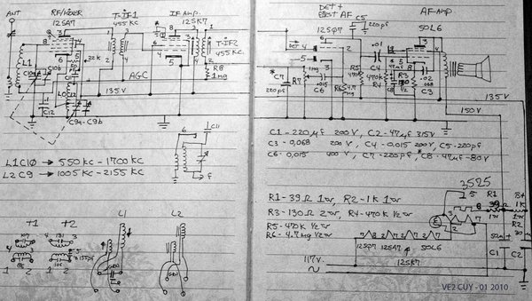
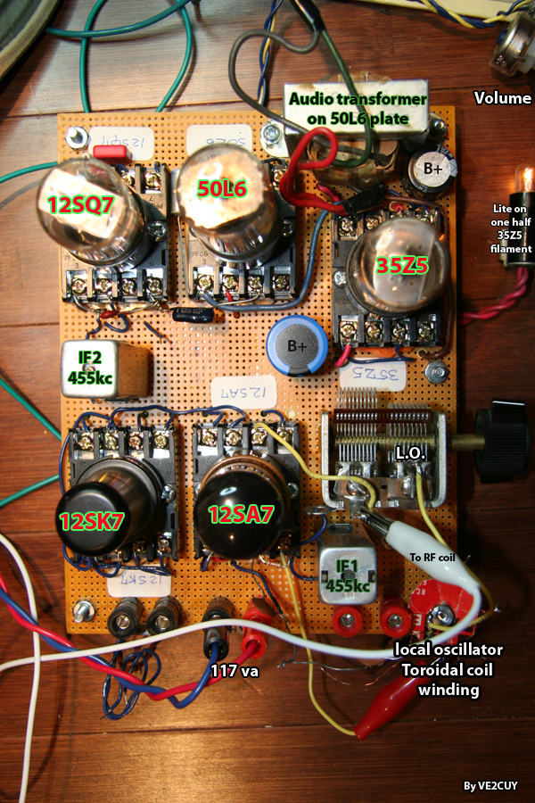

# Project 3 – Superheterodyne octal tubes

*Document converti depuis [ve2cuy.com/blog](https://ve2cuy.com/blog/index.php/vacuum-tube/project-3-superheterodyne-octal-tubes/) — dernière modification : 2010-05-23*

---

This is a work in progress. The radio will probably be completed in the first half of 2010.

It will have 5 section; rf, lo-mixer+if, if-amp2, det+first-af and af-amp.

January 8 2010

Well, I had time to complete my 5 tube radio project.

▶️ Vidéo YouTube : [Voir la vidéo](https://www.youtube.com/watch?v=PFwE5W0Id50)

I have opted for a 1940’s classic, an all American 5 superheterodyne AM receiver.

I had a few 12SA7, …, 50L6 series lying around the shack and two old 455kc ‘IF’ transformer.

The schematic is quite straight forward, the usual RF/MIXER, IF amp, DET/AF amp and power amp.

The strength of the signal – from the detector section – is use to AGC.

Tube heaters are connected in series and a 35Z5 is use to provide the B+ from an isolation transformer connected to 117AC.

It was quite fun to revisit an old part of radio history.

Oh yes, tuning was a bit tricky using a scope.  When the scope was disconnected, the circuit was detuned!  Measuring the AGC negative voltage and using my ears was much more effective.

A frequency counter was use to calibrate the L.O.

By the way, Max Robinson has a lot of valuable information on his site **‘**FUN WITH TUBES’ about tube radios and AA5 theory at <http://www.angelfire.com/electronic/funwithtubes/>.

And Dave N2DS has build very nice radios [http://makearadio.com](http://makearadio.com/tube/index.php).

