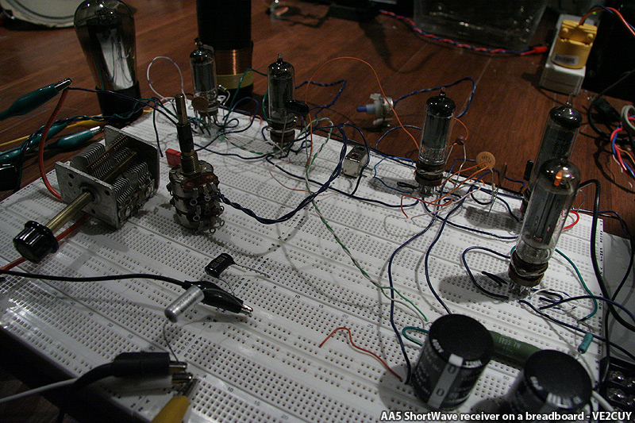
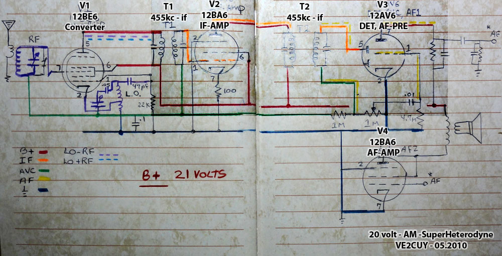
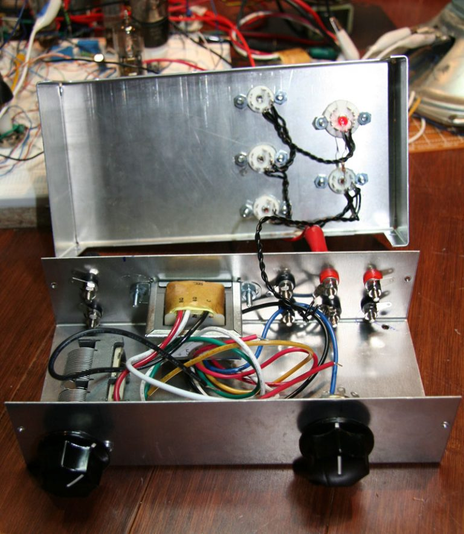
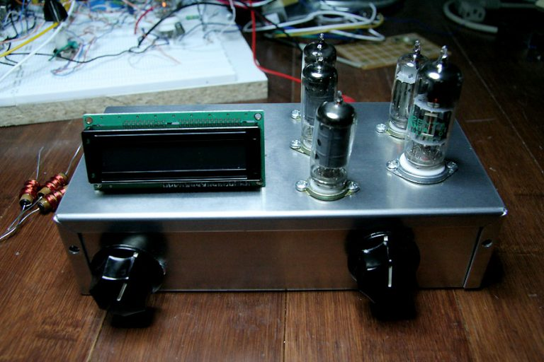
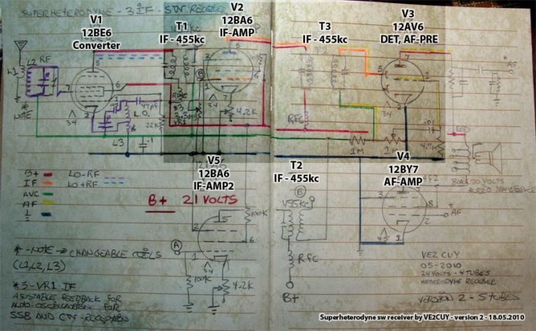

# Project 4 – SW tube receiver

*Document converti depuis [ve2cuy.com/blog](https://ve2cuy.com/blog/index.php/vacuum-tube/project-4-sw-tube-receiver/) — dernière modification : 2010-05-23*

---

**Update – 22.05.2010**

I did a little work on the project:

Replaced 10.7 “IF” cans by 455kc ones.

Selected all 12 volt filament tubes: 12BE6 (converter), 12BA6 (IF), 12AV6 (DET, AVC, AF-PRE) and 12BA6 (AF-AMP).

Fixed B+ at 20 volt (-12 + 12 from an ATX-Power supply).  Current is around 4ma (yep!).

Heaters current = 650ma.

I am starting to get results from it!

.  

▶️ Vidéo YouTube : [Voir la vidéo](https://www.youtube.com/watch?v=yLlpdj6TKAk)

Schematic – version 1

Next steps:

– add  rf amp stage  
– add a third “IF” stage (done)  
– add a magic eye tube on the AVC signal (done – but wont make it to the final version)  
– add a regeneration stage on V2 (not shure any more …)

**Update – 28.05.2010**

With the initial concept, I was thinking of a 50C5 35W4 12BE6 12AU6 12AV6 alignment with 10.7 IF.

Finally, I decided that it was too usual and I did not want it to be 117volts live.

So, the actual state of the project is:

Tubes: 12BE6 (converter), 12BA6 (IF1), 12BA6 (IF2), 12AV6 (DET) and 12BY7 (AF-AMP – It as a better sound than a 12BA6),

2 x IF stages,

3 x 455kc transformers used in transistor radios,

Controlled auto-Oscillation of the first IF-AMP (BFO) for SSB and CW reception,

Interchangeable L1, L2 and L3 for multiband,

Very low (24volts – from an ATX power supply: +12 + -12) B+. I did some tests with 12volts and it works very well with headphones.

I will add a frequency counter on the converter tube (LO – IF) to display the reception frequency using a 74HC161 and an Arduino board to drive Nixie tubes or a LCD display.

Looking at the following picture, I understand why I love those tube radio projects; they are so great in the dark…

 Nixie or LCD ? …

Schematic – version 2

**Update 20.06.2010**

I’ve made some progress on my 5 tubes shortwave radio.

The frequency counter prototype is working.

I’m using a MPF102 as an RF amp, then the signal is feed in a 74HC161 (16x prescaler) and finally into an atmega328p for counting.

See the frequency counter at work:

▶️ Vidéo YouTube : [Voir la vidéo](https://www.youtube.com/watch?v=Wd0NOFe4joQ)

=====================  
Source code:  
=====================

> /\*  
>  Project:   Frequency counter for the 5 tubes (3 IF) homemade shortwave receiver  
>  By:        VE2CUY – Alain Boudreault  
>  Date:      June 2010  
> \*/
>
> #include <FreqCounter.h>  
> #include <LiquidCrystal.h>  
> #include <stdio.h>  
> #include <string.h>
>
> //#define __debug
>
>  // initialize the library with the numbers of the interface pins  
> LiquidCrystal lcd(12, 11, 3, 2, 1, 0);
>
> // Read fz input via Atmega328 pin 11 (arduino digital 5)  
> void setup() {  
>   lcd.begin(16, 2);  
>   lcd.print(« L.O. frequency »);  
>    
>   #ifdef __debug  
>     Serial.begin(57600);                    // connect to the serial port  
>     Serial.println(« Test fz counter »);  
>   #endif  
>   lcd.clear();  
>   delay(500);  
> }
>
> long int frq;
>
> void aff_number(long int number){  
>     long int divider = 100000;  
>     long int reminder;  
>     int digit;  
>      
>     for (int i=0;i<6;i++){  
>       reminder = number % divider;  
>       digit = (number – reminder) / divider;  
>    
>       #ifdef __debug  
>         Serial.print(digit);  
>       #endif  
>       lcd.print(digit, DEC);  
>       if ( i == 1 || i == 4) {    // format -> 00.000.0  
>         #ifdef __debug  
>           Serial.print(« . »);  
>         #endif  
>         lcd.print(« . »);  
>       }  
>        
>       number=reminder;  
>       divider/=10;  
>     } // for i  
>      
>     #ifdef __debug  
>       Serial.println( » MHz »);  
>     #endif  
>     lcd.print( » MHz « );  
>      
> } // void aff_number  
> void loop() {  
>   FreqCounter::f_comp=1;  
>   FreqCounter::start(10);
>
>     while (FreqCounter::f_ready == 0){  
>       frq=FreqCounter::f_freq;  
>     }  
>       
>     lcd.setCursor(0, 0);  
>     lcd.print(« LO: »);  
>     frq\*=16;                  // Adjust for prescaler  
>     frq+=90;                //frequency fine tuning  
>     aff_number(frq);  
>     lcd.setCursor(0, 1);  
>     lcd.print(« FZ: »);  
>     aff_number(frq-4550);  //IF = 455KC  
>  }
