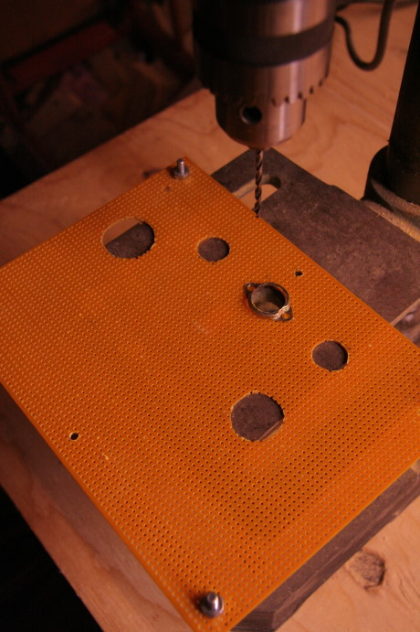
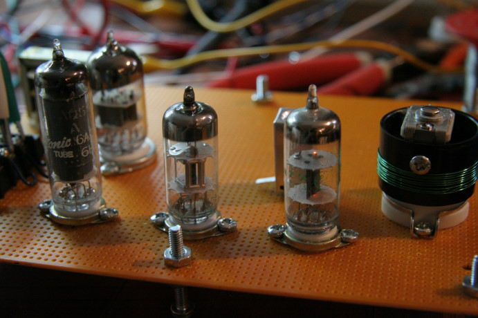
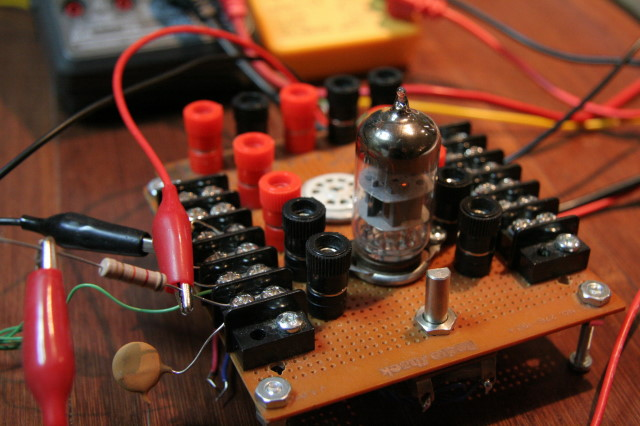
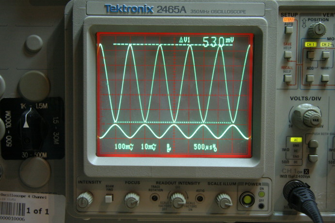
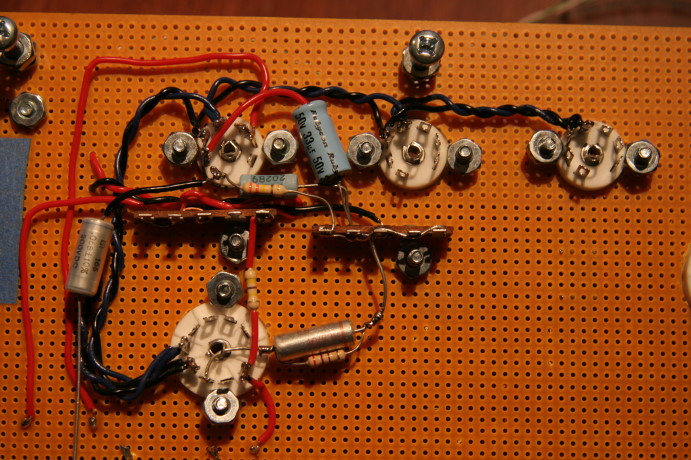
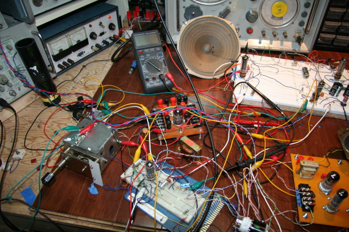
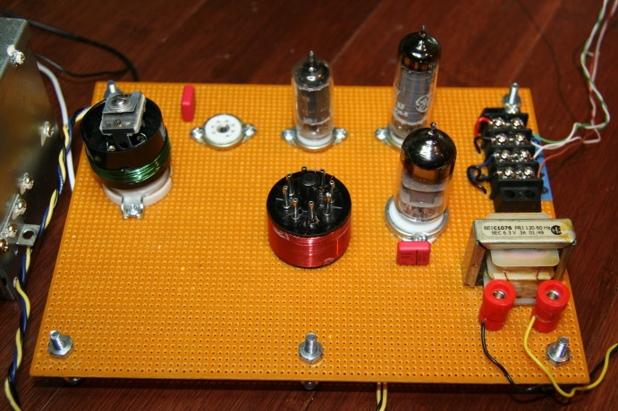

# Project 5 – 3 tube regen HF receiver

*Document converti depuis [ve2cuy.com/blog](https://ve2cuy.com/blog/index.php/vacuum-tube/project-5-3-tube-regen-hf-receiver/) — dernière modification : 2010-05-23*

---

Well, well, here is my new project:   3 tube HF regen receiver.

The idea was to design from scratch– using parts available in my shack – a regen receiver with a good audio output that would cover the HF band by using plug-in coils.

One other goal was to use same filament voltage tubes: 6BA6 (rf and regen), 6N2P (AF pre-amp) and 6AQ5 (AF AMP) and a 300 volt B+.

I’ve spent quite a time fine tuning the design.

I think that the result is not so bad at all.

There is an extra 7 pin tube socket on the board to add an ‘rf amp’ (6BZ6).

By the way, tuning the radio, I came across the ‘QSO radio show’ at 7.415 mhz. You will hear Fred Lloyd, AA7BQ founder and editor of qrz.com.

And now let’s listen to the receiver:

.  

▶️ Vidéo YouTube : [Voir la vidéo](https://www.youtube.com/watch?v=1aWvm-fqhMU)

.

Schematic will follow soon.

### Step 1:

PCB

### Step 2:

Placing the parts and testing tubes filament

### Step 3:

Working on the audio section on my prototyping board

### Step 4:

Testing AF pre-amp gain (53x)

### Step 5:

Wiring the audio section

### Step 6:

Working on the RF and regen section

### Step 7:

Wiring the RF section and testing the radio

