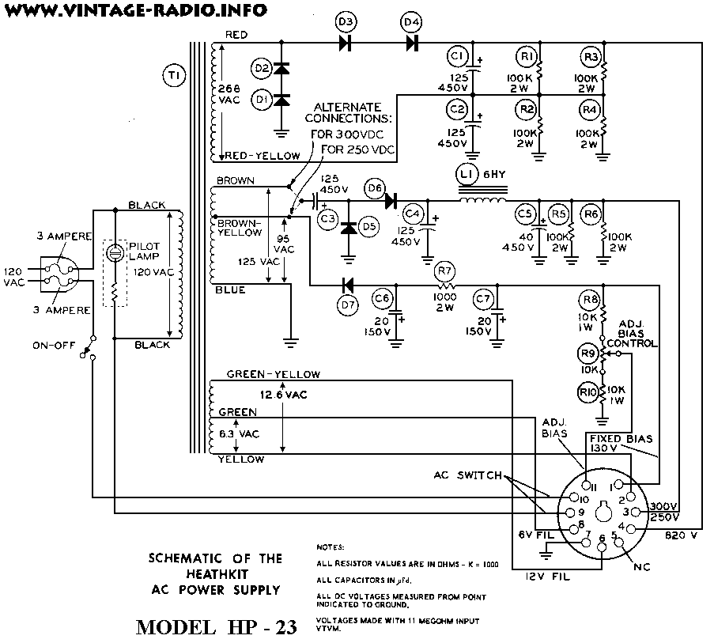
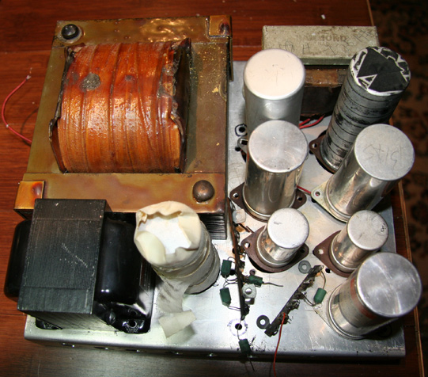
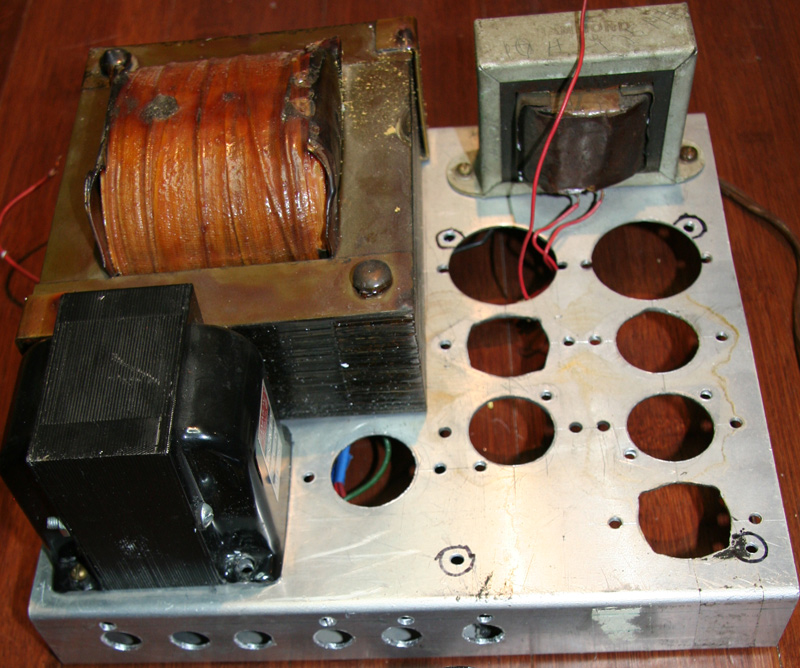
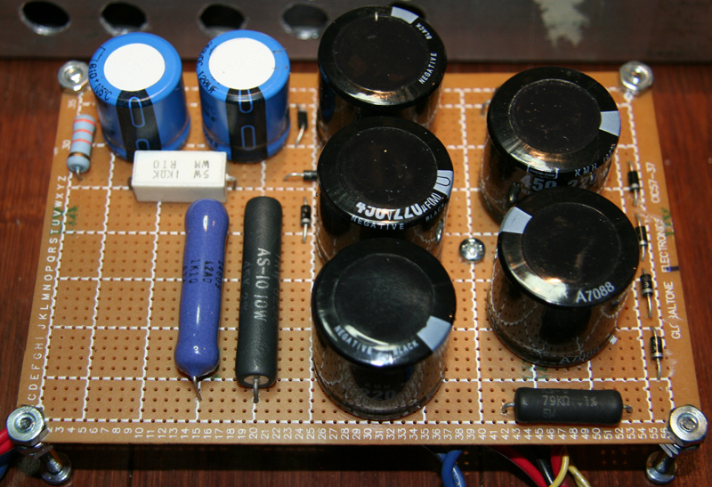
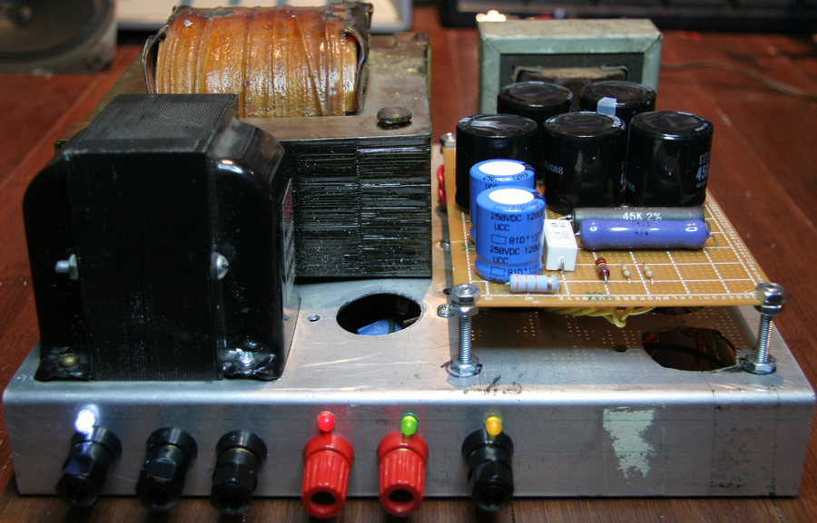
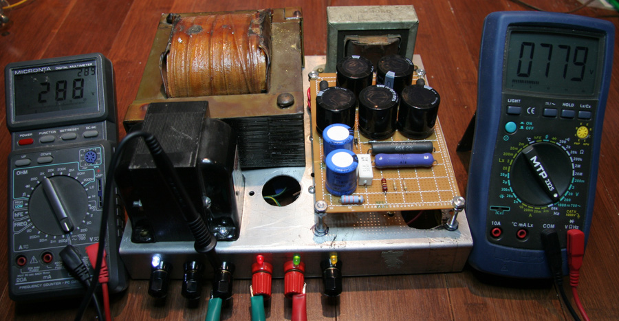
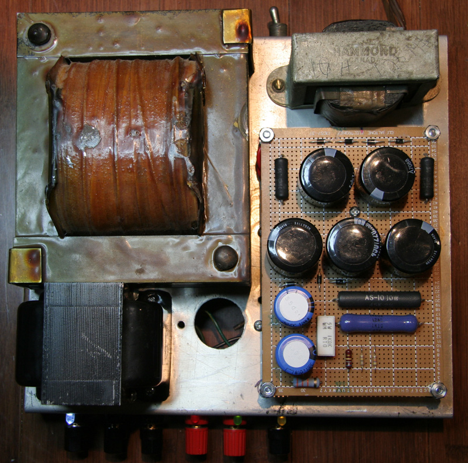

# Project 6 – Rebuild of an homemade HP-23 PS

*Document converti depuis [ve2cuy.com/blog](https://ve2cuy.com/blog/index.php/vacuum-tube/project-6-rebuild-of-an-homemade-hp-23-ps/) — dernière modification : 2010-05-23*

---

A few months ago I bought, from a Ham operator, an HW-100 transceiver.

The radio came with a homemade power supply that was a health hazard in a shack.

The HV capacitors where 450 volt HOT on the can!!!

The voltage transformer is a beef and is still working so I decided to rebuild the power supply.

Everything was strip and rebuild according to Heathkit model HP-23 PS.

The ‘new’ PS now works great!

## Pictures before:

## Pictures after:

