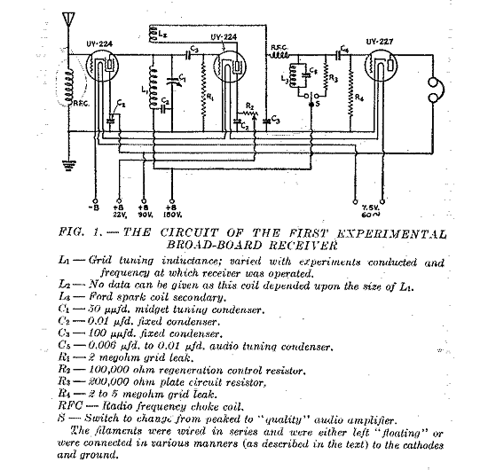
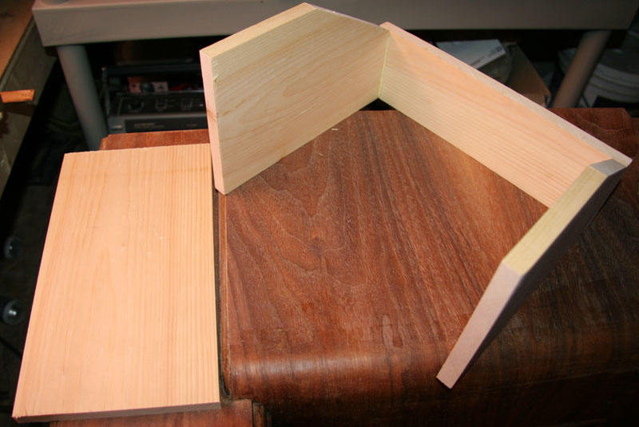
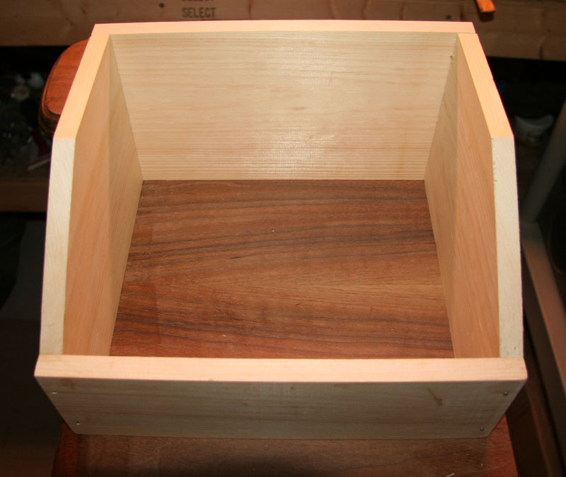
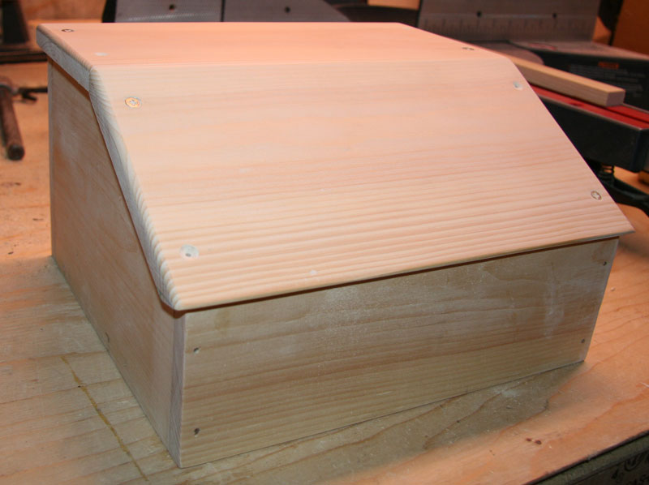
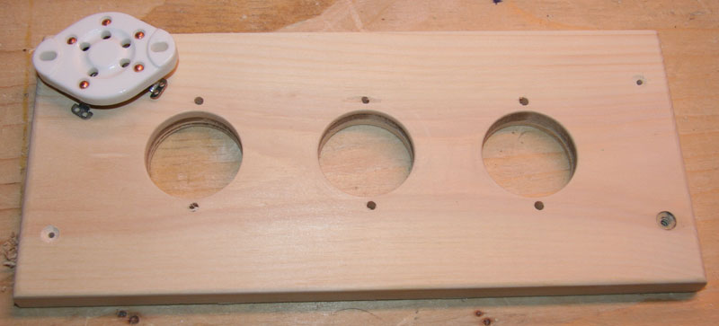
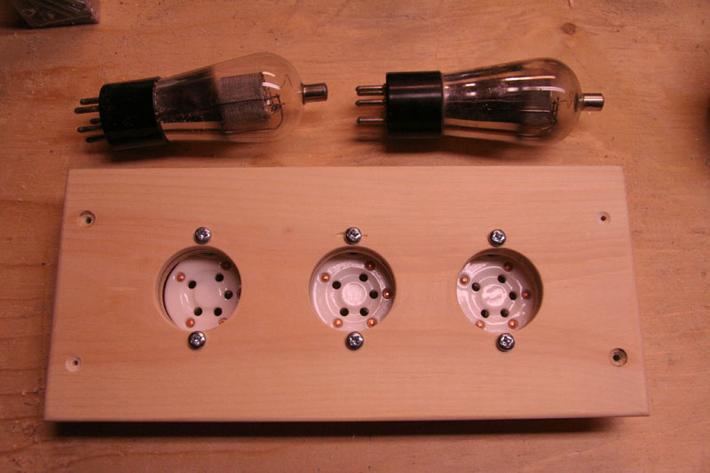
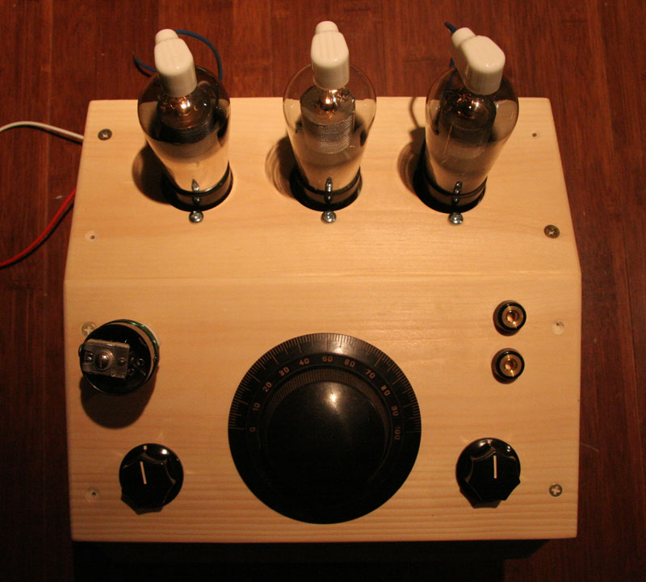
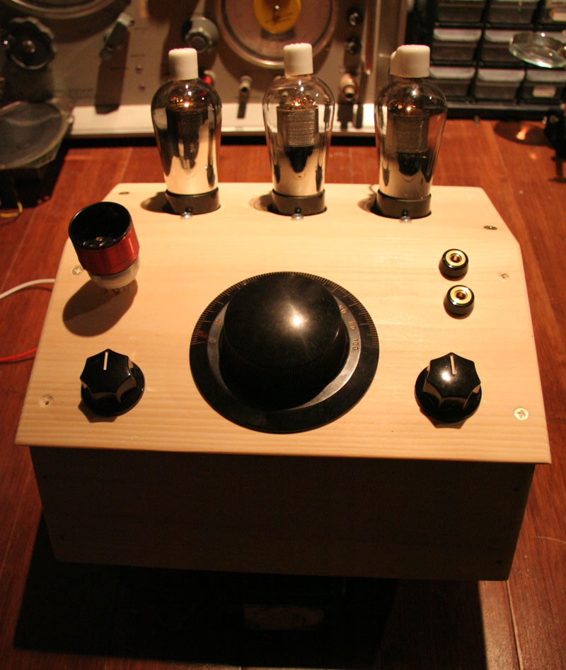
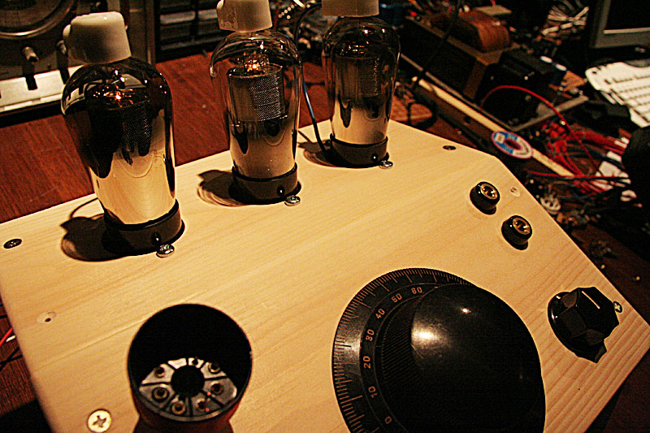

# Project 7 – 1930 style regen radio

*Document converti depuis [ve2cuy.com/blog](https://ve2cuy.com/blog/index.php/vacuum-tube/project-7-1930-style-regen-radio/) — dernière modification : 2010-05-23*

---

---

---
