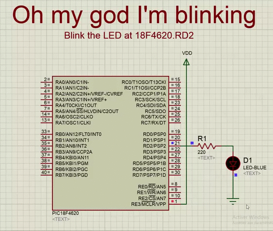
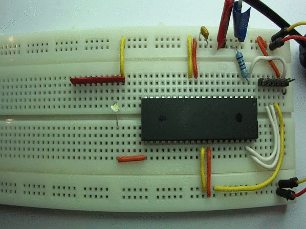

# Proteus – PIC 18F Blink a LED

*Document converti depuis [ve2cuy.com/blog](https://ve2cuy.com/blog/index.php/pic-18f-blink-a-led/) — dernière modification : 2015-03-29*

---

# Your first Proteus PIC project – Blink a LED on port RD2 of a 18F4620

This is your first PIC project ever, blink a LED, yes, I know…

But it’s a great way to learn!



[Proteus project](https://drive.google.com/uc?export=download&id=0BwVyrqVfxGkRb1R2dV9sbWlGSXM)

# The board version



# Source code

```cpp
// Main.c

#include <xc.h>;

// Default output frequency of INTOSC on Reset will be 1 MHz
#pragma config OSC=INTIO67 // use internal oscillator - Depending on your PIC this could be: #pragma config FOSC = INTOSC_EC
#pragma config LVP = OFF // Low-Voltage (Single-Supply) In-Circuit Serial Programming Enable bit (RB3 is digital I/O, HV on MCLR must be used for programming)

#define OUT 0
#define LED_PIN_DIRECTION TRISDbits.TRISD2
#define LED_PIN PORTDbits.RD2
#define END_OF_TIME 1
#define ON 1
#define OFF 0
#define _XTAL_FREQ 1000000 // needed for __delay_ms()

// This is the program entry point
void main(void)
 {
 LED_PIN_DIRECTION = OUT;
 while (END_OF_TIME) {
 LED_PIN = ON;
 __delay_ms(250);
 LED_PIN = OFF;
 __delay_ms(250);
 } // while END_OF_TIME
 } // main()
```
