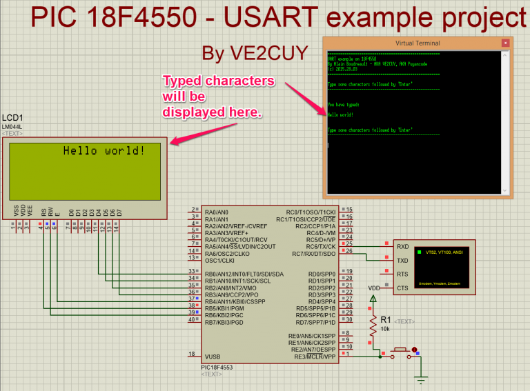
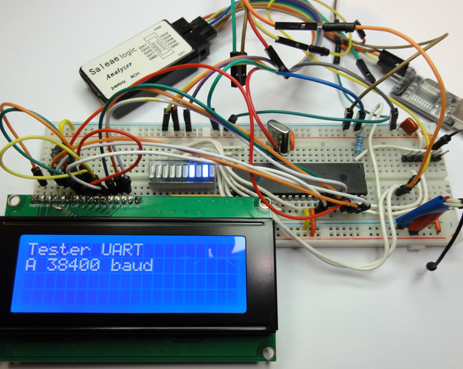
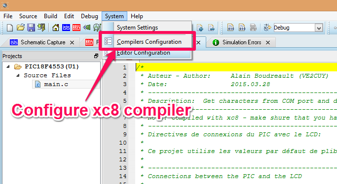
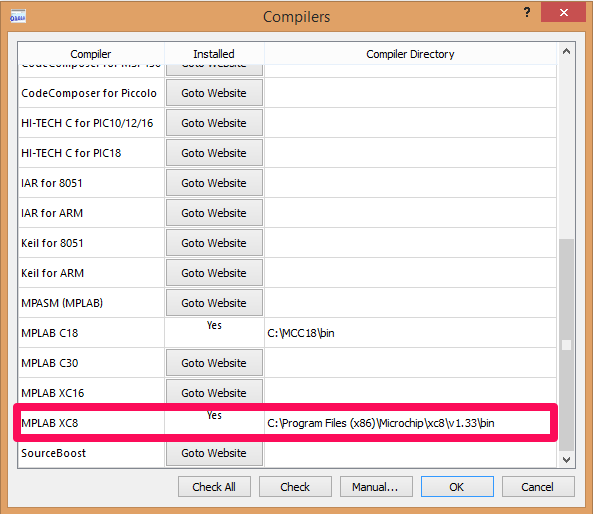

# Proteus – PIC 18F4550 USART and LCD

*Document converti depuis [ve2cuy.com/blog](https://ve2cuy.com/blog/index.php/proteus-pic-18f4550-usart-and-lcd/) — dernière modification : 2015-03-28*

---

Using Proteus, this project demonstrates how to use the 18F4550 USART to receive, using hardware interrupts, and transmit characters. The characters will be displayed on the LCD.

# The schematic diagram



# A video of the simulation

▶️ Vidéo YouTube : [Proteus simulation - PIC 18F + UART + LCD](https://www.youtube.com/watch?v=ia1Z8MHVgWc)

**Note**: On the video version of the simulation, I’m using a COM Port Physical Interface Model, [Eterlogic virtual serial port emulator](http://www.eterlogic.com/Downloads.html) and putty. The ‘**spbrg** divider’ is set to **16**: ‘*int divisor = 16;*‘

# The working prototype on a physical PIC 18F4553



To test the project in Proteus, you will need to install [MPLAB XC8](http://www.microchip.com/pagehandler/en_us/devtools/mplabxc/) on your workstation:





---

# Source code listing

```cpp
/*
 * Auteur - Author: Alain Boudreault (VE2CUY)
 * Date: 2015.03.28
 * -----------------------------------------------------------------------------
 * Description: Get characters from COM port and display them on LCD.
 * -----------------------------------------------------------------------------
 * Note: Compiled with xc8 - make shure that you have installed MPLAB XC8
 * -----------------------------------------------------------------------------
 * Directives de connexions du PIC avec le LCD:
 *
 * Ce projet utilise les valeurs par défaut de plib/xlcd.h sur BUS 4 bits
 *
 * -----------------------------------------------------------------------------
 * Connections between the PIC and the LCD
 *
 * LCD PIN PIC PIN
 * RW 5 RB6 39
 * RS 4 RB5 38
 * E 6 RB4 37
 *
 * DATA: 4 bits
 * LCD PIN PIC PIN
 * D4 11 RB0 33
 * D5 12 RB1 34
 * D6 13 RB2 35
 * D7 14 RB3 36
 *
 * UART
 * RX -> RC6 (TX)
 * TX -> RC7 (RX)
 *
 * -----------------------------------------------------------------------------
 * Data Sheet: http://ww1.microchip.com/downloads/en/devicedoc/39632c.pdf
 * See page 237 for USART
 */

#include <xc.h>
#include <plib/xlcd.h>
#include <plib/usart.h>

#pragma config FOSC = INTOSC_EC // Internal clock
#pragma config LVP = 0; // The real LCD will not work with out it. Someone knows why?
#define VITESSE_8MHZ 0b01110000
#define _XTAL_FREQ 8000000L // needed for __delay_ms()
#define BAUD_RATE 38400
#define SYS_FREQ 8000000L
#define FCY (SYS_FREQ/4)
#define END_OF_TIME 1
#define LINE_2 0x40
#define LINE_3 0x14
#define LINE_4 0x54
#define COLONNE_DROITE 19 // Last column
#define LCD_SIZE 80
#define USE_AND_MASKS

unsigned char MsgFromPIC[] = "\r\nYou have typed: \r\n\r\n";
unsigned char enter[] = "\r\n\r\n";
unsigned char info[] = "=====================================================\r\nUART example on 18F4550\r\nBy Alain Boudreault - AKA VE2CUY, AKA Puyansude\r\n(c) 2015.28.03\r\n=====================================================\r\n\r\n";
unsigned char msg_depart[] = "Type some characters followed by 'Enter'\r\n-----------------------------------------------------\r\n\r\n";

unsigned char MessageBuffer[200];
int i=0;

// ***************************************************
// Prototypes des fonctions locales au projet
// ---------------------------------------------------
// Functions Prototype
// ***************************************************
void init_XLCD(void);
void initXLCDWithShift(void);
void cls(void);
void DelayFor18TCY(void);
void DelayPORXLCD(void);
void DelayXLCD(void);
void uneDemieSeconde(void);
void afficherMessage(void);
void afficherMsgAvecDelai(char * msg[], int sec, int position);
void testerUART(void);

// ***************************************************
void testerUART(void)
// ***************************************************
{
 int UART1Config = USART_TX_INT_OFF & USART_RX_INT_ON & USART_ASYNCH_MODE & USART_EIGHT_BIT & USART_BRGH_HIGH ;

 // These are default values - but just in case:
 SYNC = 0; // Asynchronous
 BRG16 = 0; // 8-bit
 BRGH = 1; // High Baud Rate
 int divisor = 4;

 int spbrg = _XTAL_FREQ / BAUD_RATE / divisor - 1; // Set baud rate
 OpenUSART(UART1Config,spbrg);

 __delay_ms(50); // or else garbage the first time...
 putsUSART(info);
 putsUSART(msg_depart);
} // testerUART()

// ***************************************************
void interrupt traitementDesInterruptions()
// ***************************************************
{
 //UART RX ?
 if(PIR1bits.RCIF == 1)
 {
 if(i<200) //our buffer size
 {
 MessageBuffer[i] = ReadUSART(); //read the byte from rx register

 if(MessageBuffer[i] != 0x0D) {
 putcXLCD(MessageBuffer[i]); // Afficher le car sur le LCD
 PORTD = MessageBuffer[i]; // Rétroaction sur PORTD
 }
 else // Nous avons reçu un Enter -> renvoyer vers UART
 {
 for (int compteur = 1; compteur<=LCD_SIZE; compteur++)
 putrsXLCD(" ");

 putsUSART(MsgFromPIC);
 putsUSART(MessageBuffer);
 putsUSART(enter); putsUSART(msg_depart);

 for(;i>0;i--)
 MessageBuffer[i] = 0x00; //clear the array
 i=0; //for sanity
 return;
 }

 i++;
 PIR1bits.RCIF = 0; // clear rx flag
 }
 else
 {
 putsUSART(MessageBuffer);
 for(;i>0;i--)
 MessageBuffer[i] = 0x00; //clear the array
 i=0; //for sanity
 return;
 }
 } // if(PIR1bits.RCIF == 1)
} // traitementDesInterruptions()

// ***************************************************
void main(void) {
// ***************************************************

 OSCCON = VITESSE_8MHZ; // set Fosc to 8mhz
 init_XLCD();

 //Set interrupt (for USART)
 RCIF = 0; //reset RX pin flag
 RCIP = 0; //Not high priority
 RCIE = 1; //Enable RX interrupt
 PEIE = 1; //Enable pheripheral interrupt (serial port is a pheripheral)
 ei(); //remember the master switch for interrupt?

 // Display start messages on startup
 afficherMsgAvecDelai("USART test ", 1, 0);
 afficherMsgAvecDelai("At 38400 baud", 1, LINE_2);
 afficherMsgAvecDelai("By VE2CUY (c) 2015", 3, LINE_3);
 afficherMsgAvecDelai("This is line 4", 1, LINE_4);
 cls();
 afficherMsgAvecDelai(" Start putty ", 1, 0);
 afficherMsgAvecDelai("and type", 1, LINE_2);
 afficherMsgAvecDelai("some characters...", 3, LINE_3);
 cls();

 initXLCDWithShift();
 testerUART();
 while (END_OF_TIME); // This is possible because we are using interrupts for the USART

} // main()

// ***************************************************
// local functions

// ***************************************************
void init_XLCD(void)
// ***************************************************
{
 OpenXLCD(FOUR_BIT&LINES_5X7); // configure LCD: 4-bit, 5x7char, multi-lines
 while(BusyXLCD()); // Wait until LCD !busy
 WriteCmdXLCD(0x06); // 06 = pas de swift, 07 = shift vers la gauche
 WriteCmdXLCD(0x0C); // display on without cursor
 } // init_XLCD

// ***************************************************
void initXLCDWithShift(void)
// ***************************************************
{
 OpenXLCD(FOUR_BIT&LINES_5X7); // configure LCD: 4-bit, 5x7char, multi-lines
 while(BusyXLCD()); // Wait until LCD !busy
 WriteCmdXLCD(0x07); // 06 = pas de swift, 07 = shift vers la gauche
 WriteCmdXLCD(0x0F); // display on with blink cursor
 while(BusyXLCD());
 SetDDRamAddr(COLONNE_DROITE); // Placer le curseur à la dernière colonne de la ligne 1

 } // init_XLCD

// ***************************************************
// Clear LCD screen
void cls(void){
// ***************************************************
 while(BusyXLCD()); //Check if the LCD controller is not busy
 WriteCmdXLCD(0x01); // Clear LCD
} // cls

// ***************************************************
// Wait 500ms
void uneDemieSeconde(void){
// ***************************************************
 for (int i=0;i<10;i++)
 __delay_ms(50);
} // uneDemieSeconde

// ***************************************************
// Display message on LCD and wait delay
void afficherMsgAvecDelai(char * msg[], int sec, int position) {
// ***************************************************
 while(BusyXLCD());
 SetDDRamAddr(position);
 while(BusyXLCD());
 putrsXLCD( msg );
 while(BusyXLCD());
 for (int i = 0 ; i<sec; i++) {
 uneDemieSeconde();
 }
} // afficherMsgAvecDelai

// Implémentation des routines de délais pour plib/xlcd.h
// Note: Il faut définir la constante suivante:
// #define _XTAL_FREQ 8000000 // Note: 8mg est un exemple
//
// ----------- Delay functions for the LCD -----------

// ***************************************************
void DelayFor18TCY(void)
// ***************************************************
{ __delay_us(72); // Value of 18 did not work for me!
}

// ***************************************************
void DelayPORXLCD(void)
// ***************************************************
{ __delay_ms(15); }

// ***************************************************
void DelayXLCD(void)
// ***************************************************
{ __delay_ms(5); }
```

The Proteus project with source code is available [here](https://drive.google.com/uc?export=download&id=0BwVyrqVfxGkRYWFfa2FQR3NWczg).
