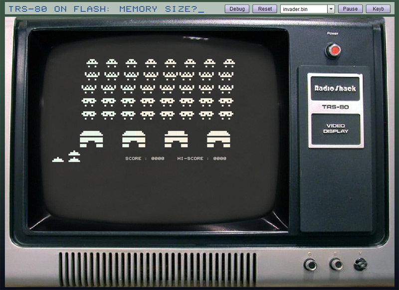

# TRS-80

*Document converti depuis [ve2cuy.com/blog](https://ve2cuy.com/blog/index.php/trs-80-emulator/) — dernière modification : 2025-11-25*

---

My first computer was a TRS-80 model 1.

I had so much fun with it that it gave me the motivation to complete a degree in computer science.

And why not write an emulator of the thing.

~~Clicking on the picture below – or Here – will bring you to my trs-80 emulator.~~

*Note : l'émulateur (application Flash hébergée sur prof-tim.cstj.qc.ca) n'est plus disponible en ligne.*

~~Old TRS-80 software here~~

*Note : les fichiers d'origine (ve2cuy.com/trs-80/trs-80.files/) ne sont plus disponibles en ligne.*

– Model 1 info:

> Address map
>
> 0000 0000 0000 0000 – 0x0000 – 00 000 – Start of ROM  
> 0010 1111 1111 1111 – 0x2FFF – 12 287-End of ROM (L2 – 12k)
>
> 0011 0000 0000 0000 – 0x3000 – 12 288-Start Reserved
>
> 0011 0111 1110 0000 – 0x37E0 – 14 304-FDC Start  
> 0011 0111 1110 1111 – 0x37EF – 14 313-FDC End
>
> 0011 0111 1111 1111 – 0x37FF – 14 335-End Reserved
>
> 0011 1000 0000 0000 – 0x3800 – 14 336-Start Keyboard  
> 0011 1000 1111 1111 – 0x38FF – 14 591-End Keyboard
>
> 0011 1001 0000 0000 – 0x3900 – 14 592-Start Reserved  
> 0011 1011 1111 1111 – 0x3BFF – 15 359-End Reserved
>
> 0011 1100 0000 0000 – 0x3C00 – 15 360-Start video memory  
> 0011 1111 1111 1111 – 0x3FFF – 16 383-End video memory (1K)
>
> 0100 0000 0000 0000 – 0x4000 – 16 384-Start of Ram  
> 1111 1111 1111 1111 – 0xFFFF – 65 535-End of RAM
