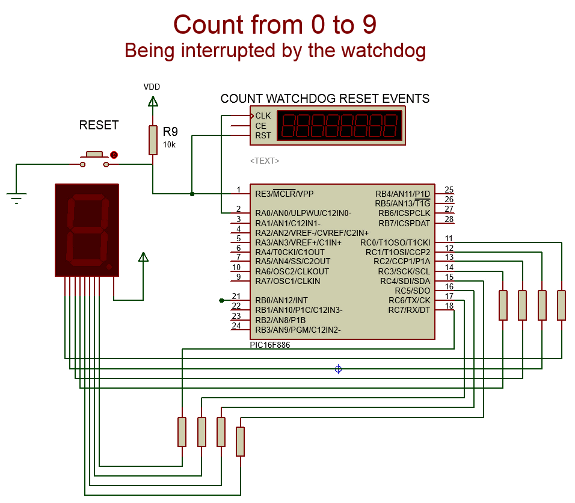
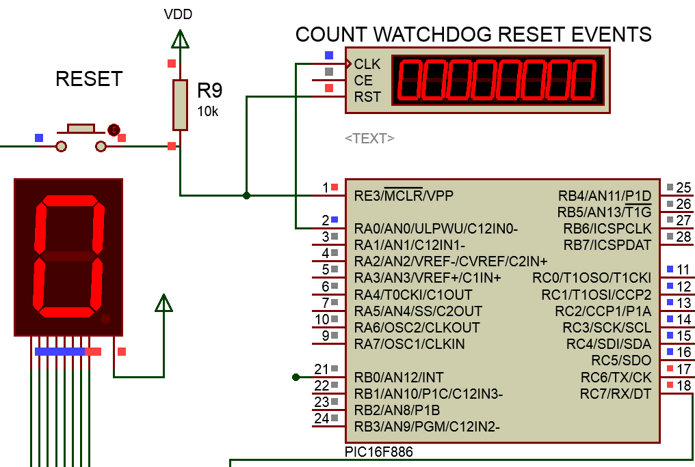
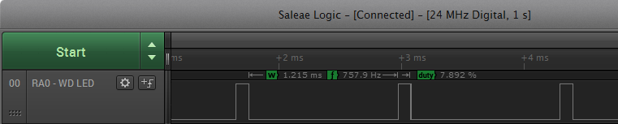
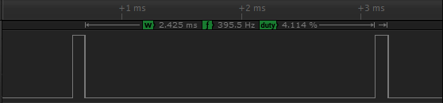
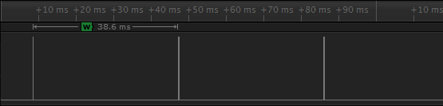
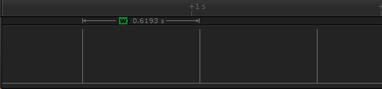
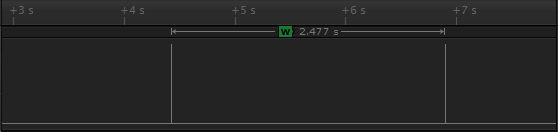

# Understanding the PIC 16F watchdog

*Document converti depuis [ve2cuy.com/blog](https://ve2cuy.com/blog/index.php/watch-the-dog/) — dernière modification : 2015-03-31*

---

### What is a micro-controller watchdog?

> « *Suppose you have written a program that is continuously running on a PIC. Now, you want to make sure that this program is always running, and that no matter what happens it will never stop. The first thing you would have, of course, is a loop back at the end of the program that brings us back to the start of the program. But consider this case. Let us say that the PIC is monitoring an input. When this input goes high, it jumps to another part of the program and waits for another pin to go high. If the second pin doesn’t go high, the PIC will just sit there and wait. It will only exit if the second pin goes high. Let us consider another example. Suppose you have written a program. You have compiled it successfully, and you have even simulated it over and over again using a simulator such as MPLAB. Everything seems to work fine. You program the PIC and place it into a circuit. However after a long period of time, the program gets stuck somewhere and the PIC gets caught in a loop. What’s needed in both cases is some kind of  reset if the program gets stuck. This is the purpose of a watchdog circuit.* »
>
> **Source from** [hobbyprojects](http://www.hobbyprojects.com/pic_tutorials/tutorial13.html).

# Example of a watchdog in action



Here, we have a classic example of a PIC being reset by its watchdog .

The PIC used in the simulation – 16F866 – has a default watchdog countdown timer of about 2.3 seconds.

So, the count from 0 to 9 is interrupted before the end of the sequence and the program is restarted.

Download the Proteus [Watchdog start project](https://drive.google.com/uc?export=download&id=0BwVyrqVfxGkReVVJZkxvV2ZLU00).

# Program listing

```cpp
/* Main.c
 *
 * By: Alain Boudreault (VE2CUY)
 * Created: mars 29 2015
 * Processor: PIC16F886
 * Compiler: MPLAB XC8
 * ----------------------------------------------------------------
 * Description: Program will try to display a count from 0 to 9
 * but will be interrupted by the PIC watchdog.
 */

#include <xc.h>
#pragma config FOSC=INTRC_CLKOUT // http://gputils.sourceforge.net/html-help/PIC16F887-conf.html
// #pragma config WDTE = OFF // Watchdog Timer Enable bit (WDT enabled) - default value is ON
#pragma config LVP = OFF // Low-Voltage (Single-Supply) In-Circuit Serial Programming Enable bit at off

#define OUT 0
#define LED_PIN_DIRECTION TRISA0
#define LED_PIN RA0 // Use to monitor the watchdog
#define END_OF_TIME 1
#define ON 1
#define OFF 0
#define _XTAL_FREQ 1000000 // needed for __delay_ms()
#define SEVENSEG_PORT PORTC

// Conversion array from digit to 7 segment LED Display
// Note: segments bit is inverted because LED display is common anode.
static unsigned char digit_to_7segment[] = { ~0B00111111, /* 0 */
 ~0B00000110, /* 1 */
 ~0B01011011, /* 2 */
 ~0B01001111, /* 3 */
 ~0B01100110, /* 4 */
 ~0B01101101, /* 5 */
 ~0B01111101, /* 6 */
 ~0B00000111, /* 7 */
 ~0B01111111, /* 8 */
 ~0B01101111 /* 9 */
 }; // .GFEDCBA

// Program entry point
void main(void)
 {
 unsigned char number = 0;
 TRISC = OUT;
 LED_PIN_DIRECTION = OUT; // Monitor the watchdog
 LED_PIN = ON; LED_PIN = OFF; // Blink when program start

 while (END_OF_TIME) {
 SEVENSEG_PORT = digit_to_7segment[number];
 __delay_ms(500);
 if (++number > 9) { // Back to digit '0'?
 number=0;
 // Blink the dot.
 SEVENSEG_PORT = ~0B10000000; __delay_ms(200);
 SEVENSEG_PORT = 0xFF; __delay_ms(200);
 } // if nb > 9
 //asm("CLRWDT"); // Clear the watchdog timer
 } // while END_OF_TIME
 } // main()
```

# How to fix the problem

1. The watchdog is not needed, disable it.
2. The watchdog is needed, configure it accordingly.

# 1 – Disable the watchdog

Uncomment line 14 of the program and run the program again

```
#pragma config WDTE = OFF // set Watchdog Timer Enable bit OFF - default value is ON
```

**Result**



The program is no longer being reset by the watchdog.

# 2 – The Watchdog Timer (WDT)

*To be completed…*

The WDT has the following features:

• Operates from the LFINTOSC (31 kHz)  
• Contains a 16-bit prescaler  
• Shares an 8-bit prescaler with Timer0 (default value)  
• Time-out period is from **1 ms** to **268 seconds**  
• Configuration bit and software controlled

# Using the timer0 prescaler

By default (PSA = 1; ), the watchdog will be using the Timer0 prescaler.

**OPTION_REG: Bit <2:0> – PS<2:0>: Timer0 – Prescaller rate selection**

| **PS2** | **PS1** | **PS0** | **TMR0** | **WDT** |
| --- | --- | --- | --- | --- |
| 0 | 0 | 0 | 1:2 | 1:1 – 18 ms |
| 0 | 0 | 1 | 1:4 | 1:2 – 36 ms |
| 0 | 1 | 0 | 1:8 | 1:4 – 72 ms |
| 0 | 1 | 1 | 1:16 | 1:8 – 144 ms |
| 1 | 0 | 0 | 1:32 | 1:16 – 288 ms |
| 1 | 0 | 1 | 1:64 | 1:32 – 576 ms |
| 1 | 1 | 0 | 1:128 | 1:64 – 1.1 sec |
| 1 | 1 | 1 | 1:256 | 1:128 – 2.3 sec |

**Table 1 – Prescaler Rate**

# Using the watchdog prescaler

PSA = 0, will enable the internal watchdog prescaler wich will give more flexibility than Timer0 prescaler.

The WDT derives its time base from the 31 kHz LFINTOSC

**WDTCON** – bit 4-1 **WDTPS<3:0>**: Watchdog Timer Period Select bits

| WDTPS<3:0> | Ratio | Period |
| --- | --- | --- |
| 0000 | 1:32 | 1 ms |
| 0001 | 1:64 | 2 ms |
| 0010 | 1:128 | 4 ms |
| 0011 | 1:256 | 8 ms |
| 0100 | 1:512 | 16 ms |
| 0101 | 1:1024 | 32 ms |
| 0110 | 1:2048 | 64 ms |
| 0111 | 1:4096 | 128 ms |
| 1000 | 1:8192 | 256 ms |
| 1001 | 1:16384 | 512 ms |
| 1010 | 1:32868 | 1 sec (default on reset) |
| 1011 | 1:65536 | 2 sec |

PERIOD =  1 / (LFINTOSC / RATIO).

Example,

1 / (31kHz / 8192) =  0,264 sec = **264 ms**

Note: LFINTOSC as +/-15% accuracy.

# Scope tests

Here are the results of a few variation of the **WDTCON** register on a logic probe:

WDTCON = 0b000**0000**0 (1ms)



WDTCON.0b000**0001**0 (2ms)



WDTCON.0b000**0101**0 (32ms)



WDTCON.0b000**1001**0 (512ms)



WDTCON.0b000**1011**0 (2sec)


